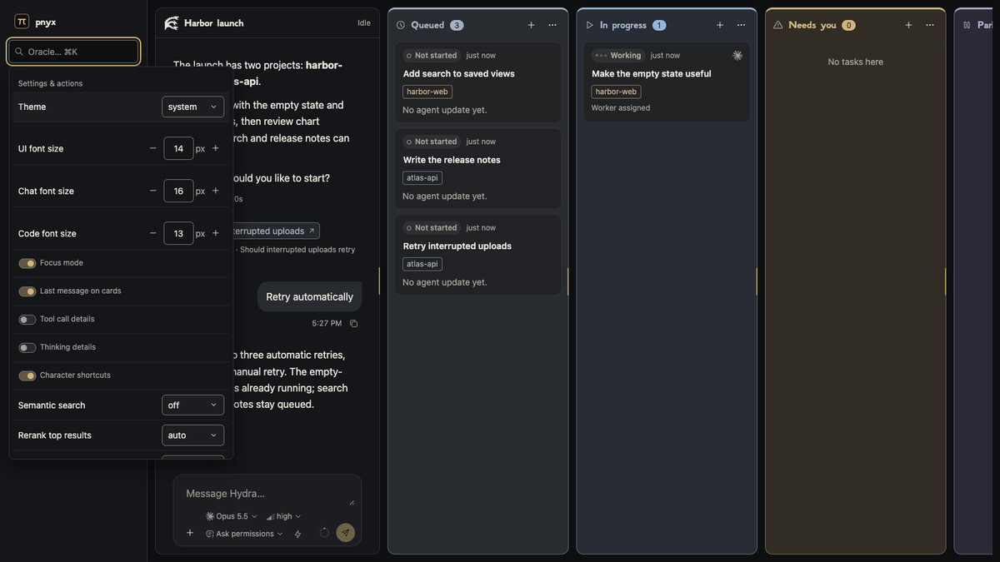

# Pnyx

Pnyx is the app, a **Hydra** holds its tasks, search is the **Oracle**, and **inscribe** is how Hydra curates and saves its memory. Everything else uses its plain name.

Pnyx tracks explicit tasks in Hydras, each an orchestrator and its tasks. The “Waiting on you” strip above Hydra’s composer lists each open owner question, permission and blocking prompt until it is answered. Select a row to reach its question or task. Create tasks and columns inline, attach an interactive agent session, and follow its updates on the card. Ad-hoc agent sessions stay in recorded history without creating tasks.

A deterministic view of every agent and its work, with an [AXI](https://axi.md/) CLI named `pnyx-axi`.

Pnyx records tasks, attaches one agent session to each task, and queues your replies to that session. It is a view over the tools you already use, not an orchestrator: Claude Code and Codex hooks report sessions, a Firstmate integration reads Firstmate's own records, and linked pull requests come from GitHub. Every change is an event in an append-only log, so the Hydra can be replayed and audited. Pre-v1.



The demo uses a synthetic fixture Hydra. It shows `pnyx-axi setup hooks`, `pnyx-axi serve --home`, a Hydra and its columns, a card opened, a card moved with `m`, a history search with `/`, and `pnyx-axi stop` plus `pnyx-axi setup hooks --remove`.

## Credits

Pnyx is built on ideas we liked from [Paseo](https://github.com/getpaseo/paseo) and [Firstmate](https://github.com/kunchenguid/firstmate), written fresh for Pnyx. A few examples:

- `inscribe` is Pnyx's take on Firstmate's `/stow`.
- Heads dispatch is Pnyx's take on Firstmate's crew dispatch.
- Hydra's always-on contract follows how Firstmate teaches its own agent.
- Starting agents and streaming their live replies follow Paseo.

## Install

Needs Node 22.13 or newer and pnpm (the version pinned in `package.json`).

```sh
git clone https://github.com/leonardourci/pnyx.git
cd pnyx
pnpm install
pnpm run build
pnpm add -g "$PWD"
pnyx-axi --version
pnyx-axi setup skills
```

`pnpm add -g` links the clone, so after a `git pull` you only rerun `pnpm install && pnpm run build`. `pnpm link --global` does not work with this pnpm; use `pnpm add -g "$PWD"` (or `npm install -g .`). Without a global install, run `./dist/cli/pnyx-axi.js` from the clone.

Setup commands for hooks, skills and the login service change user-wide configuration. They refuse a `PNYX_HOME` other than `~/.pnyx`, including previews and removals. Unset `PNYX_HOME` to use the default home, or pass `--allow-custom-home` to explicitly target another home. Installing its service also requires a `--port` that no other Pnyx home’s installed service uses; the override does not bypass that check.

`pnyx-axi setup skills` installs the Hydra skills (`pnyx-hydra`, `pnyx-hydra-workers`, `pnyx-hydra-columns`, `pnyx-hydra-firstmate`, `inscribe` and `pnyx-setup`) and `pnyx-worker` once as links into `~/.claude/skills/` (or `$CLAUDE_CONFIG_DIR/skills/`) and `~/.agents/skills/`. Workers in any project or copy can load the worker skill and report to their card. The links point to this installation, so skill updates apply without copying them into projects. Keep the installation in place; rerun setup if a link is missing. Existing files and unrelated links are preserved; move a conflicting skill aside before installing. Use `pnyx-axi setup skills --preview` to inspect the links and `pnyx-axi setup skills --remove` to remove only this installation's links. Check readiness with `pnyx-axi integrations` or Settings > Integrations.

User data lives in `~/.pnyx` by default. Set `PNYX_HOME` to keep it anywhere else; the clone holds only code.

You do not have to set everything up before the first Hydra. Each time a Hydra session opens, Pnyx checks the local dispatch config, Claude and Codex logins, hooks, global skills, quota-axi, the login service and a profile for each attached project, and puts only what is missing in Hydra's digest as a short "Setup needed" list (a complete setup adds nothing). Hydra creates the local config and writes project profiles itself, and raises the owner-only steps (hooks, skills, the login service, removing an account whose login folder is missing) as questions in its chat that run only when you Confirm. `pnyx-axi setup check` prints the same list in a terminal and exits 1 while anything is missing.

## Projects

A Hydra can work across several projects. Each project is a folder on your laptop, shown by its folder name. Attach an existing folder or clone code into a destination you choose:

```sh
pnyx-axi project add /path/to/project --hydra work
pnyx-axi project add --clone https://example.com/team/project.git --into /path/to/new-project --hydra work
pnyx-axi project list --hydra work
pnyx-axi task create --title "Ship the change" --project project --hydra work
pnyx-axi task project <task> --project project --hydra work
pnyx-axi project set project --copy '<shell command>' --hydra work
pnyx-axi project set project --landing pr --merge owner --hydra work
pnyx-axi project remove project --hydra work
```

Clone runs ordinary git directly, without sending the URL to an agent. `--into` is required. Relative paths are resolved from the CLI's working folder; in the UI, type an absolute laptop path or start with `~/`. Removing a project only detaches it: tasks, history and the project record stay. Add its path again, or choose Re-attach under Settings → Projects → Detached, to bring it back. Use a full path when folder names are ambiguous.

After a confirmed pull request merge, Pnyx refreshes the task's attached ordinary project copy. It discovers the configured remote's default branch and fast-forwards only a clean copy already on that branch. Dirty or untracked files, detached heads, feature branches, local commits outside the remote default, and locks are preserved. Task history records the observed refs and a current, advanced, needs-attention or unknown result; failures wake Hydra with the reason and a manual next step while the pull request stays merged. Refreshes sharing a repository are serialized, and a saved merge proof resumes an unfinished refresh after a server restart. Current and advanced results stay quiet. Git commands have a 30-second timeout; Pnyx never removes an existing refresh or Git lock.

An empty Hydra offers **＋ Add a folder** and **⎘ Clone a repo** where its chat will appear; the box folds away after the first project. Add a folder completes typed paths from disk and offers one-click folders recorded in agent History. Clone a repo shows the selected destination’s name and path and previews exactly where the code will land: an empty folder is used directly, while a populated parent gets a new folder named after the repository. Cloning runs locally through `project add --clone`. A folder already attached to other Hydras names every one in an inline confirmation; **Add anyway** attaches it, and each Hydra link opens in a new tab. Workers normally get their own copies; only one Hydra at a time may have a worker editing the shared folder itself.

Settings → Projects saves each project’s start command with a name and a **Brings its own folder** switch. Check it when the command creates the worker’s folder itself. Hydra’s summary, `project list` and light check include these settings. Save them from the CLI with `pnyx-axi project set <project> --command-name "Local worker" --command '<shell command>' --brings-own-folder true --hydra <id>`; an empty `--command` clears the setting. Hydra assigns the task’s project, then selects that command with `pnyx-axi task start <task> --via command --command "Local worker" --hydra <id>`. It uses the same task environment as the Hydra’s command. Pnyx normally starts it in the task’s own project copy; checking **Brings its own folder** skips that copy and runs the command from the project folder. Hydra can choose `--folder` or `--in-place` explicitly.

Workers start in their task's own copy of its project by default: on the first start Pnyx gives it a git worktree slot of the project (`hydras/<hydra>/copies/<project>-<n>`) on branch `pnyx/<hydra>-<task>`, and later starts of that task reuse it. A slot comes from the project's pool when a clean one is idle, so its ignored files such as installed dependencies stay; the branch starts from the fetched remote default branch. A failed fetch or default-branch discovery stops allocation; projects without origin use their local HEAD. `task start --in-place` works in the project folder itself instead; it is refused while a worker of another Hydra runs in that folder. A project can make its copies its own way: `pnyx-axi project set <name> --copy '<shell command>' --hydra work` runs that command in the project folder with `PNYX_TASK`, `PNYX_TASK_TITLE` and `PNYX_PROJECT` in its environment, and it prints the new folder's path last; an empty `--copy` goes back to git worktrees. A Hydra start command that makes its own folder skips the copy with `hydra set --command-folder own`.

Each project has a landing rule, chosen when it is added (the add box's **Work lands as** and **Merged by**) and changed with `project set --landing pr|branch --merge owner|hydra` or under Settings → Projects. `pr`, the default, means a worker commits, pushes, opens a ready pull request, links it, and uses `needs_you` with its URL when ready metadata is not available yet or Hydra merges it; `branch` means it commits on the task's branch and declares done. `--merge owner`, the default, asks you Merge or Hold on each ready pull request; Merge records your approval for that pull request, closes its question immediately and lets Hydra merge once checks are green; `--merge hydra` lets Hydra merge with `pnyx-axi task merge <task>`, which refuses a draft, a red check or one still running, merges with a merge commit and records it. Required checks are read from classic protection and active branch rules, including their producer apps; missing or unreadable evidence refuses the merge. The request is bound to the verified head commit. GitHub must confirm the merge before Pnyx records it; queued and unconfirmed attempts stay unfinished, retain their copies, and show on the link until the follower confirms the result. A restart resumes confirmation without submitting another merge. A definite GitHub rejection permits a fresh checked attempt; an ambiguous failure keeps waiting for confirmation. You can always merge a green pull request with `task merge`. A different rule for one task comes from telling Hydra, which records it with `task landing <task> --landing pr|branch --merge owner|hydra`. Pnyx writes the rule into every worker's header, so the worker knows where its job stops. `task status <task> done` is refused, with what is missing, while files are uncommitted or the work has not landed by the rule; you can still move the card to Done yourself.

The server follows every open pull request linked to a live task once a minute through gh-axi. A change in its state, checks or comment count is recorded on the link; nothing is recorded and nobody is woken while nothing changes. Failed checks and new review comments wake the task's worker with what happened and the gh-axi command that reads it (it fixes them on its branch rather than replying, so its own replies never come back as news); a worker waiting in `paused` also hears when checks finish. Workers never sit waiting on their pull request. Once every linked pull request of a task has merged, Pnyx declares the task done, which moves it to Done and settles its copy. Hydra makes sure every open pull request has a worker to wake: its digest marks one whose task has no worker, or whose worker ended, as unwatched, and a worker that ends with one open wakes Hydra, as does news on an unwatched one. Checks settling green or red on any open, ready pull request wake Hydra too, whether or not its worker is alive; on a task whose rule lets Hydra merge and whose worker no longer declares working, green checks wake it to merge. The card's pull request link turns coral while a check Pnyx read is failing.

An investigation (`task create --kind investigation`) answers a question or finds a cause before anything is built. Its worker stores its report with `pnyx-axi task report <task> --file report.md`, which keeps it with the task in the Hydra's log, every version included; `task report <task>` prints the latest, and the open card shows it.

Its `done` needs the stored report and an explicit review of its owner choices: `task report-review <task> --report <report-id> --none` for no unresolved calls, or repeat `--call <gated-task>/<ask-id>` for each choice. The report reader prints its id and inventory. Reuse an existing gated task when possible; Hydra asks the owner there with `task ask <gated-task> --from-report <origin-task> --question "<choice>"`, which pins the question to that report version. Completing or hiding the origin never closes these questions; they remain in Waiting on you until answered or closed with evidence. An unanswered linked question prevents its own task from hiding. Replacing a report requires a new inventory before completion, hiding or promotion. Older reports stay intact and need review at their next such transition. Recommendations needing no owner choice create no task.

The investigation copy stays after done so a build can resume in it; Hydra removes it if you decline the build. When it is done, Hydra tells you its findings in a line or two and asks **Build the fix?** on the card; your yes has Hydra run `pnyx-axi task build <task>`, which turns the same task into its build: its worker keeps its context and starts a fresh branch from the default branch, carrying over only the changes the build needs.

Related tasks can wait behind a worker already changing the same files: `pnyx-axi task queue <next> --behind <task|session> --hydra work`. Behind a session or its current task appends; behind a queued task inserts immediately after it. `task reorder <next> --behind <task|session>` changes the order, and `task unqueue <next>` frees a task for another worker. Each task needs the same project and no active worker or copy. Cards stay in Queued with “next for” and their position; the worker's card lists its queue. Use a card's menu to choose a worker, change order or unqueue. Hydra compares the task's area and expected files with live work, queues only actual overlap or dependencies, and starts independent work in parallel.

Record prerequisites with `pnyx-axi task depend <task> --on <prerequisite> --hydra work` (repeat `--on` for several); remove a relation with `task undepend <task> --on <prerequisite>`. Tasks must belong to the same Hydra, and cycles are refused. A prerequisite must finish its existing task-kind and landing lifecycle with no hold or unanswered question. An investigation needs its stored report and accepted completion; a build must land according to its rule. Task detail, the digest and timed review name unmet prerequisites. Direct starts and queued handoffs share this readiness check; independent tasks remain available in parallel. Reopening or holding a prerequisite blocks new dispatch and gives Hydra a fact about any already assigned dependent, without stopping its worker.

The server checks queues every 30 seconds. A worker keeps handling review fixes until all its linked pull requests merge. Without a pull request, the task must be declared done and its commit must land on the default branch. Once idle, the worker gets a fresh branch from the fetched current default branch, the next task's brief, and the same session and isolated folder; managed copy ownership transfers to the next task. Done cleanup retains that folder while the queue waits. Uncommitted work, missing folders, project copy commands or failed branch preparation return the queue to normal Queued with a handoff note. A dead or detached worker, a working or waiting worker stalled for 30 minutes, three completed tasks, or a 2 MiB transcript also releases the remaining queue for Hydra to dispatch a fresh worker. Unknown presence holds the queue. Firstmate-linked Hydras leave assignment and queues to Firstmate.

When a task reaches Done and its agent is no longer working, Pnyx releases its copy if it has no uncommitted changes and its work has landed: its current commit is on the fetched intended base, or a confirmed merged pull request in the same repository and branch covers it and its merge commit is on that base. Squash merges still count after the remote branch is deleted. A merged link alone never covers later local commits; dirty, divergent and unproved copies stay accessible, including after restart. A released slot goes back to the pool for the next task when fewer than two clean idle slots of that project are already there, or when an attached worker still runs in it; otherwise it is deleted with the files git ignores. A slot that an attached worker runs in is never handed to another task, so a follow-up reply resumes the worker in its own folder. The branch always stays, and a copy whose commit is on no branch is never released this way. A copy made by the project's copy command is only released: its folder stays for that command's own tool. Otherwise nothing is committed or removed; the task keeps its copy, flagged, and Hydra gets a message to resolve it. `pnyx-axi task copy <task>` shows the copy and that check, and `task copy <task> remove` checks again once the work has landed. `--safe` requires the same landing proof for a git worktree; discarding work that never landed takes `--discard` with the owner's `--confirm <token>`, never Hydra's. Queued handoff prepares the next branch and transfers its folder automatically. Manual `task attach` retains the worker's branch; the worker prepares a fresh branch before beginning the next task. On a Firstmate-linked Hydra, Firstmate makes and cleans its own copies.


Sharing a folder between Hydras requires an explicit confirmation naming the other Hydras. The CLI returns a token; repeat the attachment with `--confirm <token>`. Settings shows a confirmation dialog with links to those Hydras. Hydra's summary and light check include its projects. On a Firstmate-linked Hydra, the home’s project folders appear read-only and are managed by Firstmate.

## Run

```sh
pnyx-axi serve
```

One server runs every Hydra in the Pnyx data folder (`~/.pnyx`, or `PNYX_HOME`): one port, each Hydra at its own path, http://127.0.0.1:4747/hydra/<id>/, with http://127.0.0.1:4747 opening the default Hydra. Open the `url` it prints; `--port` picks another port, and if that port is taken, `serve` exits with `PORT_IN_USE` rather than picking another. The Hydras list in the left panel switches between Hydras on the same server, and a Hydra created while the server runs is served as soon as its folder appears. A Hydra that fails to load is skipped and reported (in the `serve` output and at `/health`), and the others keep working. Each Hydra keeps its own hook socket, its linked Firstmate home and the agents Pnyx started for it, all inside that one process. `pnyx-axi` with no arguments shows the Hydra summary and the running server's address. Stop a foreground server with Ctrl+C or `pnyx-axi stop`, which stops the server of every Hydra. The login service uses the Node executable and Pnyx installation that ran setup, reaching Node through a link on `PATH` such as `/opt/homebrew/bin/node` when one points to it, so a Homebrew upgrade keeps the service starting; keep that installation in place and rerun setup after moving it or switching Node. Rerunning setup on a running service replaces it in place: it waits for launchd to finish stopping the old job before starting the new one. Each Hydra permits one server even when two starts race. A service-managed server restarts after `stop`; use `setup service --remove` to keep it stopped.

The browser reconnects automatically with capped backoff and a heartbeat, resumes Hydra events and restores the open conversation subscription. Composers stay usable during an outage; submitting a message keeps its draft and sends it when the connection returns, using the same delivery key on retries. Hydra chat counts a message as sent once its saved event or receipt is confirmed, even while Hydra is still preparing its reply. An uncertain chat or agent-settings save shows a checking state and retries with the same operation ID through reconnects and reloads; a late confirmation clears it. A refused send returns to the composer with the time it failed above it. The pnyx name in the left panel shows an offline mark when the server cannot be reached. Session identities and attachments live in the event log and survive browser reloads and server restarts.

Type `/` anywhere in Hydra’s composer to find skills and commands. The picker shares the mention picker’s keyboard controls: typing filters and selects the first result; Tab or Enter inserts it, and Escape closes it. Pnyx’s Hydra skills, global skills, the session’s native project skills, readable agent commands and skills from every attached project are grouped by source. Selected skills stay inline as one gold badge, with a leading star, the project’s existing coloured label when applicable, and the full `/skill` name.

The server keeps a metadata index of skill folders, following file changes and checking file stats so edits, replacements and new skills appear on the next menu opening without a page reload. The browser preloads skills when the composer connects and keeps the last list for each Hydra and agent in the tab. Opening the menu shows that list immediately, with no loading indicator, while a background read checks the index; an unchanged result keeps the displayed list in place. Native selections resolve to the receiving harness’s syntax when sent (`/name` for Claude Code, `$name` for Codex). A skill from another attached project sends an explicit instruction to read and follow its `SKILL.md` path; it is never installed or registered with the agent for automatic use.

Replies from Claude Code and Codex agents that Pnyx runs type into Hydra’s chat as they are written: word by word, left to right, at the pace they arrive, catching up within 0.4 s after a pause and finishing within 0.3 s of the reply's end. Half-written formatting such as an unclosed `**` or a table header without its delimiter row waits until it can show whole. Working dots appear before the reply starts, and new messages arrive with a short animation. Reduced-motion preferences turn off the animations, the typing and the scroll glide; text then shows as it arrives, still without half-written formatting. The completed reply stays in the harness’s recorded transcript.

When the server restarts on a new build at the same port, an open Hydra reloads itself and keeps the open card, unsent drafts and scroll position.

To keep it running in the background:

```sh
mkdir -p ~/.pnyx
pnyx-axi setup service                     # macOS: start now and at login, restart after exit
pnyx-axi setup service --port 4748         # on another port
pnyx-axi setup service --preview           # inspect the launchd configuration
pnyx-axi setup service --remove            # stop and uninstall the service
```

There is one login service for every Hydra. Setting it up replaces the one-per-Hydra services older versions installed for the same data folder.

### Named links with portless

[portless](https://github.com/vercel-labs/portless) gives local servers stable HTTPS names such as https://pnyx.localhost instead of port numbers. The server accepts any `*.localhost` host and origin: browsers resolve those names to this machine themselves, so another site cannot rebind them. Set it up once (it asks for your password once):

```sh
npm install -g portless
portless trust && portless service install   # trust its certificate, run its proxy on port 443 at login
portless alias pnyx 4747                      # https://pnyx.localhost for the login service
```

Start a preview server under a name of its own, so its link is https://<name>.pnyx.localhost. `serve` takes the port portless hands it in `PORT` when `--port` is not given, and a data folder of its own keeps it apart from the login service's Hydras:

```sh
PNYX_HOME=<dir> portless <name>.pnyx pnyx-axi serve
```

## Add your agents

```sh
pnyx-axi setup hooks                    # Claude Code and Codex, whichever config folder exists
pnyx-axi setup hooks --harness codex    # just one
pnyx-axi setup hooks --preview          # show what would change
pnyx-axi setup hooks --remove           # take Pnyx's hooks out again
```

This adds a silent reporting hook to `~/.claude/settings.json` and `~/.codex/hooks.json` (`CLAUDE_CONFIG_DIR` and `CODEX_HOME` are honored), keeping every other hook. Hooks record sessions for explicit attachment and watch one thing in each, as Paseo does: whether the agent is working on a turn (from a prompt or tool call) or finished it (Claude Code's and Codex's Stop hook), shown as a small indicator on the card. Ad-hoc sessions never create tasks; sessions without an interactive terminal stay in recorded history. Each interactive session records the terminal it runs in so the Hydra can type your replies into it: a tmux pane, a Herdr pane, a Paseo terminal, or an iTerm2 or Terminal window (macOS asks once to let Pnyx control that app; the answer lives under System Settings > Privacy & Security > Automation). A task without a reply route reports a delivery error; failed CLI sends retain their recorded delivery state. Already had the hooks installed? Re-run `pnyx-axi setup hooks` to enable typing into sessions. Codex asks you to review and trust new hooks once: run `/hooks` in Codex after installing. Rerun `pnyx-axi setup hooks` after upgrading Pnyx so the hooks cover the events the new version reads.

## Firstmate

Each Firstmate home gets its own Hydra. `pnyx-axi hydra homes` lists the homes beside each other, as `new-firstmate` makes them (in `FIRSTMATE_FACTORY_BASE`, by default `~/projects/agentic-engineering-workflow`; `--base` picks another folder), and the Hydra each one has; `pnyx-axi hydra create --firstmate <home>` creates a Hydra named after the home. `pnyx-axi setup hydra --home <home> --hydra <id>` makes the home that Hydra: it copies the Hydra skills into the home's `.agents/skills/` as local skills (listed in the clone's `.git/info/exclude`, so Firstmate's tracked files never change) and leaves Firstmate an inbox note pointing at it. A Hydra run by a Firstmate home watches that home when served, without `--home`.

`serve --hydra <id> --home <home>` uses a home that Hydra has not recorded; a Hydra mirrors one Firstmate home, and `serve`, `firstmate sync` and `firstmate watch` name any other home they ignore. The server watches the home's `state/` and `data/` folders, turns each task into a card, and sends your replies through the home's own `bin/fm-send.sh`. Apart from `setup hydra` adding its local skill, it only reads the home. Without a server, `pnyx-axi firstmate sync --home <path>` folds a home in once and `pnyx-axi firstmate watch --home <path>` keeps doing so; `pnyx-axi reply <id> --text <text> --home <path>` replies from the terminal. The first interactive Claude Code or Codex session in an open task's worktree joins that task; a later session in the same folder stays unassigned. The managed task keeps replying through Firstmate. A setting change from a task card's Agent tab goes to the orchestrator as a request note through the home's `bin/fm-inbox.sh note --request-id <id>`, with the same request id retained on retries. When Firstmate records a Paseo terminal, only sessions in that terminal can join or replace its worker; a replacement on the same terminal continues the task while earlier sessions remain in recorded history.

## Task records

Hydra can be Firstmate or an ordinary agent session. Each Hydra has one orchestrator identity, and each explicit task has zero or one attached worker. Tasks support one level of subtasks. Pnyx records work and queues messages; Hydra decides what to do and dispatches workers. Changing Hydra preserves tasks, earlier worker attachments and messages to previous Hydras.

Use `hydra create|set|show|list` for Hydras, `column create|rename|describe|rule|resize|delete|reorder|list` for their columns, and `task create|brief|hide|unhide|hide-after|rename|status|ask|answer|escalate|list|show|history|chat` for work records. `task create --parent <task>` creates a subtask. Creating a task in a role column records that role's initial status. Pnyx moves a card on an explicit lifecycle change (see Columns), the owner arranges the rest, and Hydra uses manual placement only for owner requests or exceptional corrections; `move <task> <column> [--before <task>]` (or dragging the card) places it by hand. `column delete <id> --to <column>` moves every task in the deleted column to `--to` (the first remaining column by default), and Undo refuses to overwrite later edits. The final column cannot be deleted. CLI card moves, column rule edits, column reorders and column deletes first return `confirmation: needed` with a token and a summary; repeat the exact command with `--confirm <token>` to act. A changed target invalidates the token. Browser gestures act directly on the owner’s instruction. Hydra’s own changes (writes with actor `hydra`) through `move`, `task create|brief|hide|unhide` and `task start` must carry one short `--reason "<why>"`. Pnyx stores the reason on the event and shows the change in the task’s Updates. Changes made during your turn fold under Hydra’s reply, grouped by task. The owner’s own moves and edits need no reason.

Create a task with `task create --title "<title>" --ask "<owner words>" --brief "<build instructions>"` and edit its brief with `task brief <task> --brief "<instructions>"` (empty text clears it). Starts include the brief in the opening prompt, whether Pnyx runs the agent or it starts through Paseo, Firstmate or the configured command. An explicit `task attach` sends it through the attached agent’s reply route once per attachment; the attachment receipt includes its delivery result. `task hide <task>` removes work from the live Hydra and `task unhide <task>` restores it; both are events and preserve all history.

The owner's ask is append-only and appears before Hydra's build instructions in task details and worker prompts. `task intent <task> --text "<owner words>"` adds a later ask with its time; messages sent directly on the task are added automatically. Hydra must supply `--message <saved-owner-message-id>` when quoting the owner at intake or adding an ask, and Pnyx checks the exact quote. Rewriting the brief never changes the ask. Workers account for each part of the ask in their completion note.

Hover the agent icon on a card to see its model, settings, session details and recorded task tokens. `task show` includes the same token totals, from supported worker transcripts and Hydra turns that explicitly name the task. Worker handoffs keep earlier usage on the earlier task. Missing transcripts and unattributed Hydra turns are excluded; the display makes no estimate. Shared Hydra turns are identified in the usage explanation.


Set a reminder by telling Hydra “remind me about this tomorrow” or using a card’s hover pill → Remind. The CLI is `pnyx-axi task remind <task> "tomorrow 9:00" --hydra <id>`; it also accepts `"in 2 hours"` or a future ISO timestamp with a timezone. “Tomorrow” uses the laptop’s timezone and defaults to 9:00. Each task has one reminder: setting another replaces it, and `task remind <task> clear` clears it. Waiting reminders appear on cards; `task reminders` returns their list and count, also available at `/hydra/<id>/reminders` for the panel. When a reminder falls due, the server records one event, moves the card to Needs you (restoring that column if it was deleted), brings a hidden card back, and posts a reminder in Hydra’s chat. Hydra’s light check includes the due event. Missed reminders fire when the server next starts; no agent is started and nothing is deleted. On a Firstmate-linked Hydra, an unchanged record leaves a due reminder in Needs you; clearing the reminder or new Firstmate records resumes source placement.

Columns carry an executable placement rule and a description, available through `column list` and set with `column create --description "<when and why>"` or `column describe <id> --description "<when and why>"`. `column rule <id> --when "<fact>[,<fact>]" --reason "<why>"` replaces a rule after confirmation. Commas mean AND, repeated `--when` options mean OR, and `!fact` means NOT; the first matching column in display order wins. `column rule <id> --clear --reason "<why>"` makes it manual only. Rules use worker state (`worker:none|working|checks|blocked|hydra|paused|ended`), `owner-question`, `held`, pull request state and checks (`pr:none|draft|open|pending|green|red|merged|closed`), `kind:build|investigation`, `done`, `reminder-due`, and `queued` behind a worker. A custom Research column before In progress can use `--when "kind:investigation,!done,!held,!owner-question,!reminder-due"`. New custom columns start manual only. `column list` and the digest print every rule. `column resize <id> --width <pixels>` and `hydra resize --width <pixels>` persist widths. `layout show` reports overrides and stored defaults (290 pixels per column, 360 for Hydra); `layout reset` restores those widths while preserving other preferences.

Owner memory is Pnyx-wide: every Hydra's full digest prints it. It holds the owner's preferences under the key `preferences` and general learnings under `learnings`, through `owner memory list`, `owner memory set --key <short-name> --text "<document>"` and `owner memory forget --key <short-name>`, within 24000 characters. It lives in `$PNYX_HOME/owner/memory.jsonl` (by default `~/.pnyx/owner/`), an append-only log that keeps every replacement and removal. Saves take `--if-revision <n>` from `owner memory list`, so a save made from an older read is refused rather than replacing another Hydra's save. The first run of this version moves each Hydra's `preferences` and `learnings` there, merging lines that repeat, and forgets them in the Hydra, whose event log keeps the old text; a Hydra that cannot be moved keeps them in its digest and the next read retries.

Hydra reports results in plain words with full links, what waits on you and what happens next. Routine progress stays on the cards. Owner messages always call for an answer; if a hosted Hydra ends one with `NO_REPLY`, Pnyx asks once for a standalone reply.

Standing worker instructions reach every new worker header, after its fixed scope and authority lines: Hydra-wide notes first, then project notes, both verbatim and deferring to those fixed rules. Read them with `hydra memory list` or `project show <name>`. Save the whole document with `pnyx-axi hydra worker-notes set --text "<instructions>" --reason "<why>" --hydra <id>` or `pnyx-axi project worker-notes set --project <name> --text "<instructions>" --reason "<why>" --hydra <id>`; `forget` clears it. Each document is limited to 1500 characters within its memory layer's budget. Every edit is recorded and posts a line as Pnyx in the editing Hydra's chat. When workers repeatedly stop on something your standing preferences settle, Hydra answers the worker and adds a short rule here so future workers have it too.

Each owner or project learning line keeps its own last-confirmed time and unused-save count. Normal learnings become stale after 30 days or 10 unused memory saves, whichever comes first. Add short-lived “for now” lines with `memory set --key learnings --text "<whole document>" --kind for-now --until <condition>`; the flags apply to new lines only. These become stale after 7 days or 3 unused saves and must name `task:<hydra>/<task-key-or-id>`, a full PR URL, `version:<version>`, or `date:YYYY-MM-DD`. Dates expire at midnight UTC. Task completion and followed PR merges are checked from saved Pnyx state; versions and unavailable task or PR state need Hydra's evidence. Digests and timed reviews surface stale and expired lines without changing memory.

Finish an inscribe pass with `owner memory save --reason "<what you checked>"` or `project memory save --project <project> --reason "<what you checked>"`. Each advances only that layer's unused counts. Add `--used "<exact line>"` (newline-separated for several) with session evidence in the reason to refresh their dates and clear their counts instead. Reads, document edits, wakes and timed reviews never advance counts. Reconfirm a line with `owner memory confirm --text "<line>" --reason "<session evidence>"`, or the project equivalent. Recheck stale lines, then confirm or use `memory archive --text "<line>" --reason "<why>"`; the append-only archive event preserves text and metadata, exposed by `memory list` for recovery through a new set. Old logs need no rewrite: missing kind and count mean normal and zero. Preferences stay undated and never decay.

Hydra memory holds only what one Hydra needs, such as its scope, where it left off and its check cursor, through `hydra memory list`, `hydra memory set --key <short-name> --text "<fact and why>"` and `hydra memory forget --key <short-name>`, within 1500 characters. Entries replace by key, survive a Hydra switch and remain isolated to their Hydra; all replacements and removals stay in the event log. In both layers a save that would exceed the budget is refused, and the digest asks Hydra to curate a nearly-full memory. Before a context reset Hydra runs the `inscribe` skill, Pnyx's take on Firstmate's `/stow`: it routes each fact to owner, project or Hydra memory and saves the documents it changed.

Project memory is shared by every Hydra that attaches the same normalized git remote, including different clones and worktrees. Repositories without a remote use their canonical path. It lives under `$PNYX_HOME/projects/<id>/events.jsonl` (by default `~/.pnyx/projects/<id>/`), separately from Hydra state. The `profile`, `preferences` and `learnings` documents share one 10000-character budget; over-budget saves are refused and the digest nudges Hydra to curate nearly-full memory. Project preferences stay until changed. General owner preferences belong in owner memory.

Hydra writes the first profile from the project's default-branch AGENTS.md, CLAUDE.md, README and skills: build/test/lint commands, PR rules, key skills and when to use each, and main conventions. Pnyx hashes those sources without model calls and marks the profile out of date when they change. It reads locally available default-branch refs without fetching; changes must reach that ref to invalidate a profile. With no git repository, it hashes the attached folder's sources. A repository whose default branch is unavailable cannot acknowledge a profile refresh. The next Hydra reads only changed sources and replaces the profile; preferences and learnings remain. The digest lists attached projects in a one-line index with profile freshness; Hydra loads a project's memory on demand with `project show <name|path>`. Workers receive a short version for their assigned project.

Curate through chat or `inscribe <project>`. `pnyx-axi project memory list --project <name|path> --hydra <hydra>` prints documents, usage, source hashes, changed files, the source ref and its fingerprint. Read files with `git -C <project> show <ref>:<file>`; then save a profile with `project memory set --project <name|path> --key profile --text "<profile>" --sources <fingerprint> --reason "<why>"`. Use the same command with `--key preferences` or `--key learnings` without `--sources`, or `project memory forget --project <name|path> --key <key>`. Writes support `--event-id` and `--if-revision` using the project memory revision. Replacements and removals stay in the append-only project log. Move one owner learning with `owner memory move --project <name|path> --text "<exact learning line>" --if-revision <owner revision> --hydra <hydra>`. One durable entry in the owner log records the removal and project addition together; project replay includes these moves in sequence with its own events. The move preserves the learning metadata, refuses growth over the project budget and leaves both memories untouched on refusal. When owner memory is nearly full, inscribe moves clearly project-specific learnings itself; moving owner preferences requires an answered owner question. Hydra names applicable project skills in each task brief, and the standard worker header tells workers to read their current copy's AGENTS.md and CLAUDE.md plus the relevant skills, docs and context files they point to.

A Hydra that Pnyx runs works from `~/.pnyx/hydras/<hydra>/agent/`. Before each Hydra turn Pnyx writes its contract there as `AGENTS.md`, with a one-line `CLAUDE.md` importing it, so Claude Code and Codex load Hydra's whole job every turn, plus the detail skills the contract tells it when to load. Pnyx gives Hydra a full digest of its live state, owner memory and Hydra memory when a session opens and after compaction, plus a compact attached-project index. Wakes into a running session carry the change/check prompt, the open decisions and a one-line note when memory changed; `pnyx-axi hydra digest` prints the same digest for a Hydra run anywhere else. Every worker a Hydra starts opens with one generated header that states its task, that it stays in its own copy, runs routine commands without asking, escalates only real decisions to Hydra, and where it stops: its project's landing rule, or an investigation's stored report.

A task's status is an explicit declaration or a successful task/agent operation's recorded lifecycle fact (working, needs_you, paused, blocked or done) shown on its card, and its lifecycle places the card: see Columns. Pnyx declares a task done itself only once every non-abandoned linked pull request has merged. Silence, finished turns and session exit do not complete tasks. Firstmate's backlog, status text and worker metadata are mirrored into retained task records, including backlog items without workers. A Hydra stops mirroring a home when that home no longer runs it.

The append-only log preserves Hydra, task, subtask, session, command and message identities. Replaying existing events migrates old session records without changing their event bytes or ids. Unattached and headless sessions remain available through CLI history and search. Harvested user and assistant messages are redacted and copied into the log on turn end, attachment changes and explicit `harvest`, so observed conversations remain readable and searchable after a native transcript disappears. Oracle remains a derived, deletable index.

`hydra send --text <message>` queues a Hydra-level message with no task, and `hydra stop` ends the turn Pnyx's hosted Hydra is running without touching its workers. `hydra send --task <task> [--action send|worker]` queues a task-specific message, and `hydra messages` reads the queue. These actions never launch a worker; starting one is `task start` (below). A worker's own message (actor `worker:<task>`) reaches Hydra wrapped as a `<pnyx-report>` with its origin and stays out of the owner's chat; Hydra tells the owner what it decided. Hydra’s own messages (actor `hydra`), including the lines Pnyx posts for its changes, appear in the chat as Hydra’s and stay readable through `hydra messages`, task history and `hydra check`, which lists them without waking on them. Several workers per task and automatically generated labels are later work.

Native tasks have an event-backed steering inbox. Enqueue with `pnyx-axi task inbox enqueue <task> <message-id> --text "<instruction>"` (or `--file <path|->`). Inbox writes use message and attempt IDs for retries and reject `--event-id` and `--if-revision`. A message ID identifies one instruction: retrying it preserves its number, and the same text with a new ID creates another instruction. `--source` and `--reply` retain its origin and reply correlation.

Workers run `pnyx-axi task inbox read <task>` to read pending instructions in numeric order and obtain the current session/generation claim. After incorporating the oldest instruction, they run `pnyx-axi task inbox ack <task> <message-id> --session <session> --generation <number>`. If incorporation is blocked, `--outcome blocked --note "<why>"` records that checkpoint; any owner question is filed separately. Acknowledgement means the instruction was addressed, not that the task is finished. `read --all` includes handled history. Detaching or replacing a worker invalidates its old claim while preserving pending instructions.

`task inbox notify <task> <message-id> --session <session> --generation <number> --attempt <attempt-id> --result delivered|unknown|failed|deferred` records a notification attempt separately from handling. The inbox is rebuilt from the append-only event log through the normal snapshot projection. Existing reply receipts retain their delivery meaning; ordinary replies to native tasks persist their full payload in this inbox before notifying a hosted Claude/Codex worker, a Paseo agent or a terminal worker. Their reply ID is the message ID, and the runtime receives a short notice naming pending IDs. Opening or resuming a hosted worker replays unacknowledged IDs in order, even when an earlier notification was delivered. A held worker stays held. Controls, permission answers and question answers retain their dedicated delivery paths. Workers checkpoint effects before acknowledgement so recovery can verify work already performed. The server follows the oldest unread instruction even after a delivered receipt: after 90 seconds it allows at most three scheduled notification attempts, with a separate bound of two busy/held deferrals. Attempts are reserved durably before sending, so a crash or reassignment cannot reset that budget. Exhaustion records one actionable “instruction unread” result for Hydra in the same event that wakes it; the instruction stays pending until acknowledged. Acknowledging it lets the next instruction advance. Restart/resume reconciliation retains the same IDs and is separate from the scheduled budget. A hold never resumes its worker. Terminal notices require a verified empty Claude Code/Codex composer in tmux; drafts and permission prompts defer them, and terminals without a safe composer inspection report uncertainty without typing. Paseo agent notices use its message API without changing a UI draft. Legacy unconfirmed receipts retain transcript-based uncertainty checks. Firstmate-owned tasks keep Firstmate's inbox.

Native tasks can register external jobs or listeners for the existing server to supervise outside agent turns:

```sh
pnyx-axi task source register <task> job --executable /absolute/path/to/tool --argv '["listen","job-id"]' --cwd /absolute/project --hydra work
pnyx-axi task source list <task> --hydra work
pnyx-axi task source read <task> job --hydra work
pnyx-axi task inbox ack <task> <result-message-id> --session <session> --generation <number> --hydra work
pnyx-axi task source handled <task> job <sequence> --session <session> --generation <number> --hydra work
pnyx-axi task source stop <task> job --hydra work
```

Registration binds an assigned worker's session/generation, the executable's real path and SHA-256, exact argv and working folder. Arguments are passed directly without a shell. Register only a trusted command; files named in argv remain that command's responsibility. The same source ID and configuration is idempotent; choose a new ID for changed configuration or a replacement worker. Completed output first enters a private capture buffer, then becomes an event before its stable inbox message is queued or a notification is sent. The buffer survives a writer failure or server restart and is removed after the event is flushed. A process exit or successful notification leaves its result unread. A worker acknowledges the inbox message when addressed, then the current worker explicitly marks the result handled when fully resolved; terminal handling retires the source. `read --all` includes handled results.

The default limits are one hour, 64 KiB combined stdout/stderr and a one-day registration expiry. Set `--timeout-ms` (up to one day), `--max-bytes` (up to 1 MiB), or `--expires <ISO-time>` explicitly. `--restart on-failure --max-runs <1–10>` allows another confirmed failed run only after its result is handled; the run count survives server restarts. Successful, stopped, expired, oversized, interrupted and stale-owner results are terminal. An interrupted listener has an uncertain external outcome: verify the external job before registering another source. The server never guesses that rerunning an interrupted command is safe.

The server owns one listener per registration. Its child supervisor stops the source's process group when the server connection closes. Restart replays unread results and records a lost listener as interrupted. Holds retain captures and queue their inbox messages without resuming the worker; expired registrations and replaced workers cannot launch old commands. Failure, uncertainty, hidden or held results, and acknowledged results left unfinished after a worker turn create one durable Hydra alert per result. These alerts can start Hydra even before its first chat message. Hidden results remain readable and enter the task inbox when the task returns. Firstmate-owned tasks continue using Firstmate's external-source lifecycle.

Workers can put an already-open Lavish page on the same durable transport:

```sh
pnyx-axi task source lavish <task> page-1 --page .lavish/review.html --executable "$(command -v lavish-axi)" --hydra work
pnyx-axi task source read <task> page-1 --hydra work
# After incorporating the round and acknowledging its inbox message:
pnyx-axi task source lavish <task> page-2 --page .lavish/review.html --executable "$(command -v lavish-axi)" --after page-1 --sequence 1 --session <session> --generation <number> --agent-reply-file reply.md --hydra work
```

The worker owns the page and its feedback; Hydra relays its link. A registration binds the canonical page, worker claim, exact predecessor round and optional reply text/identity. The server posts a staged reply once through `lavish-axi reply`, saves its acceptance receipt, then launches `poll`. Registration alone does not mean listening: inspect the source's running state and reply acceptance first. A failed or interrupted post remains an unread result and never starts a poll. Repeating the same registration preserves its identity; a round cannot acquire a second successor. Apply and checkpoint all feedback before acknowledging it. Re-arm handles that exact acknowledged round and registers its successor together. Real owner choices use `task ask` and the existing report-review inventory.

An empty End or feedback with `session_ended` remains owed until handled, then retires; re-arm is refused. Unknown responses and disconnected sessions also stop for worker attention. Polls use the existing one-day limit and capture bounds. A server restart preserves registrations, receipts and unread rounds. A lost running poll produces an interrupted result; the worker checks the uncertainty and explicitly re-arms instead of blindly replaying a destructive read. Expired, stale-assignment and explicitly stopped registrations can also be recovered by the current worker after acknowledgement; none restarts automatically. Lavish consumes feedback when returning it, so output lost before reaching the source supervisor cannot be recovered by Pnyx. Reply acceptance has no remote idempotency key: an uncertain post requires inspection before another explicit publication.

## Starting workers and Hydra

Hold an idea for discussion with `pnyx-axi task create --title "Idea" --hold` or `task hold <task> --reason "Discuss first"`. It stays in Backlog marked **Talking** and cannot start, build, queue or continue. Once Hydra has played back its understanding, it asks `task ask <task> --to owner --kind go --question "Ready to build?"`; the card moves to Needs you. Answering **Go** releases the hold and closes the question together. **Hold** keeps the discussion held. Hydra can also release with `task release <task> --from-message <owner-message-id> --reason "Owner approved"`, quoting an owner message newer than the hold.

`pnyx-axi task start <task> --via pnyx|paseo|firstmate|command` starts one worker for a task and attaches it; `pnyx-axi hydra start --via paseo|firstmate|command` starts the Hydra. Pnyx runs the agents it is asked to start; Hydra still decides what to do. Pnyx records each start on the Hydra.

- **Pnyx (the default):** `task start <task> [--rule <name>] [--harness claude|codex] [--prompt "..."] [--folder <path>]` has the Hydra’s server (`pnyx-axi serve`) run Claude Code through the Agent SDK or Codex through `codex app-server` in the task's folder, with the brief as its first prompt. It records the native session or thread id, folder and settings on the task and loads your own provider configuration, skills and hooks. Install the chosen provider's CLI and sign in before starting. Hooks report to the same task. The chip reads **Claude Code · Pnyx** or **Codex · Pnyx**; `pnyx-axi reply` and model, effort and mode changes through `pnyx-axi agent` go straight to it, and working or finished comes from the agent itself. Codex applies picker changes on its next turn. A message sent during a turn joins it, as with Claude Code (Codex takes it through `turn/steer`); one sent while a turn is being stopped starts the next turn instead. Stopping the server stops its agents: after a restart each task still shows its agent, and the provider's conversation remains available through CLI history, a running turn is marked interrupted and waits for you or Hydra, and the next message resumes the same session or thread. Tool permission requests appear inline with **Allow / Deny** and a **Needs you · permission** marker; the card stays in its column. Hydra sees them through `hydra check` and can answer with `pnyx-axi task permission <task> <request> allow|deny --actor hydra --reason "<why>"`; its reason appears in Hydra’s chat. Your own permission rules run first, so tools they already allow never ask in the Hydra. The first answer wins and does not change your permission rules. Command and file approvals apply once; Codex turn-permission requests show their turn scope and never grant session-wide access. Requests the agent no longer waits for expire, including after a server restart. Codex's mode selects its approval policy (`untrusted`, `on-request` or `never`) with its sandbox: `never` runs with full access, the others write only in the task folder and Pnyx's home. `bypassPermissions` is `never`, so nothing asks.
- **Paseo:** with [Paseo](https://paseo.sh) running, `--via paseo [--rule <name>] [--harness claude|codex] [--prompt "..."] --folder <path>` asks the local daemon (`PNYX_PASEO_URL`, default `ws://127.0.0.1:6767/ws`) to start a Claude Code or Codex agent; the conversation and replies then go through Paseo, and the agent stays in Paseo too. Pnyx says so when Paseo is not running and never starts it. `task paseo` checks the daemon.
- **Firstmate:** on a Hydra run by a Firstmate home (the default route there), `--via firstmate [--prompt "..."]` puts a worker request in Hydra's chat and hands it to Firstmate as an inbox note. Firstmate dispatches the worker; its mirrored task can be nested under the Hydra task.
- **Your own command:** `pnyx-axi hydra set --hydra <id> --command '<shell command>'` sets a command, run in the task's folder with `PNYX_HOME`, `PNYX_HYDRA`, `PNYX_TASK`, `PNYX_ROLE` (`worker` or `hydra`), `PNYX_TASK_TITLE`, `PNYX_PROMPT`, `PNYX_HARNESS` and `PNYX_FOLDER` in its environment. The session it starts attaches to its task, or becomes Hydra, when its hooks first report.

Every agent Pnyx starts carries `PNYX_HOME` and `PNYX_HYDRA`, so its hooks report to the Hydra that started it, even from a separate Pnyx home, once `pnyx-axi setup hooks` has installed this version's hook. `pnyx-axi integrations` shows which of global skills, hooks, Paseo, Firstmate, the configured command and GitHub are ready, with the command that sets each up; the same list is under Settings > Integrations.

### Kinds, the light check and the worker contract

```sh
pnyx-axi rule init --shared
pnyx-axi rule list
pnyx-axi rule set review --when "Independent code review" --candidates '[{"harness":"codex","model":"gpt-6.1-sol","effort":"high"},{"harness":"claude","model":"claude-opus-5-5","effort":"high"}]'
pnyx-axi task start <task> --rule review
```

- **Heads dispatch:** Hydra chooses a named rule for the work; each rule has a plain-language `when` and a candidate list of harness, model and effort (plus optional mode and Fast). `task start --rule <name>` selects within that list; without a rule it uses `default`. An explicit owner `--harness` or `--model` wins even outside the rule, checked against that harness’s own catalog and login. Quota does not veto that choice; `--effort`, `--mode` or `--fast` alone choose nothing, so quota still picks the candidate and skips spent accounts. `--model`, `--effort`, `--mode` and `--fast on|off` replace the chosen candidate's settings for that start, from its first turn; the task records the override. `rule set <name> --when "..." --candidates '<JSON array>'` replaces a candidate list; the single-candidate flags `--harness`, `--model`, `--effort`, `--mode` and `--fast on|off|default` are convenient for one candidate. Empty model, effort and mode flags clear those settings. `rule remove <name>` removes a named rule. Settings → Agents shows effective rules, login folders and account order. Ask Hydra to propose changes in chat, then use Confirm or Dismiss there.

The shipped template offers Claude and Codex in every rule: Sonnet 5.5 and gpt-6.1-sol at medium effort by default, Haiku 5.5 and gpt-6-luna at low effort for mechanical work, and Opus 5.5 and gpt-6.1-sol at high effort for well-defined implementation or xhigh for investigation. Hydra chooses the best-fitting named rule; quota-axi ranks its candidates.

Every owner-only CLI action Hydra attempts becomes a saved question with one-click Confirm and Dismiss in chat, including changing permission modes, Hydra command/session settings, project settings, setup and discarding copies. Only owner confirmation executes the stored command; repeated clicks never run it twice, and changed targets require a new question. Hydra’s existing permission prompts also remain answerable in chat. A Hydra Pnyx runs in Bypass permissions, or Codex's Never ask with full access, runs these actions on its own Hydra, and rule and account changes, at once; its own permission prompts, approval answers and questions already waiting still need you.

Hydra proposes changes with `rule propose set|remove|accounts` or `account propose set|remove`, using the same arguments as the direct commands. Pending changes survive restart and appear in Hydra’s chat. Only the owner can apply one with Confirm (or `rule confirm <token> --confirm <token>`). Dismiss leaves config unchanged. A change to the underlying config invalidates confirmation.

Heads dispatch reads `~/.pnyx/config/hydra-heads-dispatch.json` and the account registry `~/.pnyx/config/hydra-accounts.json` (`$PNYX_HOME/config/` when set). Each Hydra may override them with `heads-dispatch.json` and `accounts.json` in its Hydra directory. Missing or empty top-level sections inherit the shared section; nonempty sections replace it in full. Account records live under `accounts` and contain only `provider` (`claude` or `codex`) and `folder` (an absolute login folder or `~/...`). Pnyx never stores tokens. The repository ships only templates, `setup/config/hydra-heads-dispatch.example.json` and `setup/config/hydra-accounts.example.json`, with one Claude and one Codex login and example rules. `rule init --shared` copies them into `~/.pnyx/config/` without overwriting existing files; edit that local copy to list your actual accounts and rules before starting work. Until a dispatch file exists, Pnyx uses the template's rules, `rule list` suggests running `rule init --shared`, and Hydra runs it itself when its digest lists the missing config under Setup needed; until an accounts file lists accounts, workers use each harness's own login. Everything personal (accounts, rules, preferences, memory and project profiles) lives only in the Pnyx home and is never committed. `account set <name> --provider claude|codex --folder <path> [--shared]` and `account remove <name> [--shared]` edit the registry.

The dispatch file's `main` names the account Hydra runs on. Its `workers` maps each provider to an ordered list: for example `{"claude":["claude:work","claude:personal"]}` spends the worker account before falling back to the main one. `projects` optionally maps absolute project paths to provider account orders; a nonempty provider order there replaces that provider's worker order for tasks assigned to the project. Use `rule accounts --main claude:personal --provider claude --order claude:work,claude:personal [--shared]`; add `--project <absolute path>` to set a project override. For rule dispatch, an account must be registered and listed for that provider. An explicit owner start can use a registered account or the harness’s default login when no worker order exists, and skips proven signed-out logins while preserving the chosen harness and model. For rule dispatch, a signed-out account stops the start and reports the account to sign in; only a spent account falls through to the next listed account. Hosted Claude workers receive the selected `CLAUDE_CONFIG_DIR`, hosted Codex workers receive `CODEX_HOME`, and the same login folder is kept when their sessions resume.

Pnyx reads each account with `quota-axi --no-credential-refresh`, adding `--profile-only` when the account names a login folder other than the harness's default, so only that folder is read; a default login is read the way its harness reads it, and joins its model evidence through `quota-axi models`. It skips models the harness's catalog does not list and candidates exhausted now. A candidate is bounded by the lowest `effective.selection.spendPriority` of its account and model windows; candidates with a known value rank highest first, and unknown quota ranks below every known one, independent of list order. A tie, or several candidates with unknown quota, stops the start and names them (`--harness` settles it when they differ by harness); a single usable candidate with unknown quota starts with that uncertainty recorded. Stale readings are treated as unknown. Pnyx-hosted starts check models against the Claude Code and Codex catalogs the Hydra's server reads; for Paseo, its offered models are checked before selection. The chosen rule, model, account and quota evidence appear on the task. If every candidate is spent or unavailable, the start stops: Hydra must tell the owner, and Pnyx never switches to a weaker rule or an unlisted account.

Existing event logs with agent kinds keep loading: their named agents become one-candidate rules and their default agent becomes the default list until a local heads dispatch file exists. `rule migrate --hydra <id>` writes those rules into the Hydra's file without changing the event log. The old kind commands and `--kind` start flag are removed. Legacy quota buckets no longer choose models implicitly; list the allowed models explicitly in each rule. Hosting Hydra itself inside Pnyx remains outside this feature; an existing `hydra start --via paseo` uses the configured main account.
- **Direct conversations:** owner messages sent through CLI task replies are recorded with their send receipts. The light check also archives native transcript messages and completed Paseo replies into the same event log, including chats retained after detach and messages from an earlier task attachment. It returns a compact `conversations` digest grouped by task; Hydra treats the owner’s direct words as instructions and decides whether to act or take note. Excerpts point back to full task history, and the `through` cursor pages every event without dropping the rest. Echoes of Hydra sends and Hydra’s own answers are excluded from the digest. Unavailable native sources are reported for a later retry. Workers can escalate directly with `hydra send --task <task> --text "<question and context>"`.
- **Light check:** `hydra check` also returns an `agents` list with each attachment’s session, harness, launch route, folder, start time, last observation and current presence. A terminal observed before this boot or a process that exited is `gone`; a daemon or process that cannot be queried is `unknown`. These are observations for Hydra to inspect with `task history` and `task show --full`; Pnyx never relaunches agents. `hydra check` prints only what Hydra tracks (messages, task creation, brief and visibility changes, declarations, open agent questions, attachments, column changes, manual moves and links) after `--after`, with each event's id, task and message action, and skips Hydra's own writes (actor `hydra`, from `PNYX_ACTOR` or `--actor`). With `--wait` it blocks until one appears, so a background command or monitor wakes Hydra only when something changed, without loading the Hydra. A Hydra that Pnyx runs is refused `--wait`, since a waiting shell call would hold the owner's messages until it returns.
- **Wakes:** when Pnyx runs Hydra, its server queues one short check turn a few seconds after something needs Hydra's judgment: a worker report or question, a `needs_you`, `blocked` or `done` declaration, a permission request, a worker turn that finished while it still declares `working` or has declared nothing, checks settling green or red on an open, ready pull request, a linked pull request merging, a worker ending with an open pull request, a prerequisite becoming unmet or clearing, or a reminder coming due. A plain `working` or `paused` declaration that does not change prerequisite readiness and Pnyx's own moves stay on the card until Hydra's next wake; worker progress reports (`hydra send --kind progress`) go quietly to the routine helper when eligible, and otherwise join the next main wake. Each change or stall wake opens with `Why you are woken:` and one line per fact, `- [@Title](pnyx-task:<id>) <kind>: <detail>`, from a fixed list of kinds (`declared`, `asked`, `report`, `turn ended`, `checks`, `comments`, `merged`, `approved merge is green`, `quiet`, `permission`, `wait ended`, `not confirmed`, `reminder due`, `queued`, `queue released`, `kind`, `prerequisite`, `slot free`); a fact about a pull request carries its full link, and a `done` declaration while Backlog has ready cards adds `slot free` with them in order. The lines are worked out when each change lands, and a change wake ends by telling Hydra that a result always gets a reply. Every change, stall and `back after outage` wake also lists the open decisions on live tasks, oldest first: owner and worker questions, pending permissions, blocking prompts and pull requests Hydra may merge, or `Open decisions: none` when nothing waits; an item leaves the list once nothing waits on it any more. Nothing a worker sends interrupts Hydra: what arrives while it works waits, then reaches it as one turn holding each report and, when other changes came in too, a `hydra check` from the last wake, so Hydra answers a burst once. A wake counts as handled when Hydra's turn finishes, so a turn that fails offers the same updates again once Hydra runs. Your own messages never wait: one sent while Hydra works joins the running turn. Above the composer, the running line counts update records as “Reading N updates”, adding “across M tasks” when several tasks contributed. Hover or focus the count to see each task title and update kind, including waiting updates; it clears when the turn ends. Hydra's own writes (its session runs with `PNYX_ACTOR=hydra`) wake it only when prerequisite readiness changes, a busy or interrupted Hydra is not woken, and changes and reports made while the server was stopped wake it once it is back. A worker turn cut short by a server restart continues once by itself, and a hosted Hydra turn cut short resumes once: Hydra rereads unanswered messages and the changes it was checking. If that recovery turn is interrupted or fails, Hydra waits for your next message.
- **Routine helper:** each hosted Hydra has its own background helper conversation. Fixed rules send task-local progress, worker questions, turn ends and stuck-worker nudges to it; results, PR checks and merges, timed reviews, and every task touching an open owner decision stay on the main Hydra. A mixed batch stays on main. Each helper batch gets one turn bounded to two minutes, the shared Hydra contract beneath its own actor instructions, recent owner conversation, and task leases that exclude main from acting on those tasks. Main sees the active grants and their start times in its digest and inputs; reports held by an active batch stay out of main’s report envelopes. The helper keeps its supplied `helper:<batch>` actor and omits `--actor`. It resumes interrupted hosted workers with `reply` and uses `task continue` only for eligible ended outside sessions. It may answer workers’ in-scope questions; creating work, changing settings, merging and answering owner decisions remain main-only. Both harnesses receive an output schema; each task summary must be one nonempty line of at most 600 characters. Supplied links are copied exactly, missing links are omitted, and Pnyx adds task references. Routine outcomes are recorded quietly in the event log. Owner outcomes reach main as one line each and remain pending until main finishes its reply. A failed or interrupted helper hands its original wake to main without retrying; owner messages never queue behind it. The default helper is Sonnet beside Claude and gpt-6-luna beside Codex. Configure it with `hydra set --helper claude|codex --helper-model <id> [--helper-effort <value>] --hydra <id>`, restore the default with `--helper auto`, or use `--helper off` to route every wake to main.
- **Timed review:** every 30 minutes while a worker is attached, a pull request or decision is open, or Backlog has ready work, Pnyx wakes Hydra to catch stuck or silent work. It lists live task facts and ages, ready Backlog cards in order and available capacity, then flags approved green merges, reported external PR blockers, old owner questions, missing workers, unwatched pull requests and a memory cursor behind the log. Pnyx has no configured worker limit. Reviews wait for Hydra's turn to finish and include open decisions and reply rules. Their run and offered question reminders are recorded, so a restart repeats neither within their intervals. Set the cadence with `pnyx-axi hydra set --review-minutes <n> --hydra <id>`; 0 turns it off. A task finishing, detaching its worker or merging also wakes Hydra with ready Backlog work.
- **Stalls:** they make no event, so the server polls for them and wakes Hydra: a permission request pending 4 minutes, a working worker silent for 4 minutes or idle while still declaring working, one inside a single tool call for an hour, a paused worker whose wait ended (its `--until`, or 4 hours; a `--hold` the owner or Hydra asked for never ends on a timer), and a reply its worker's session never showed after two resends. A stall still there after Hydra's turn comes back, each time after twice the last gap, up to an hour.
- **Hydra's health:** when Hydra's session cannot start (a harness login, settings, or a resume that times out), Pnyx records Hydra as down, posts a line in the chat, and tries again after 1, 2, 5 and 10 minutes and then every 10, also after a server restart; each of your messages and each worker wake tries too, and each message of yours that fails says so. When a start works, Pnyx records Hydra as up and posts "Hydra is back after N min". Hydra's first turn back lists your messages that no turn of its took, and worker reports from the outage follow in its next wake. A Hydra held by an outside agent is not Pnyx's to start, so its refusal is posted once and never retried.
- **Workers:** a worker follows the `pnyx-worker` skill and reports with `task status <task> working|needs_you|paused|blocked|done --note <text>`; silence, idling and exit change nothing. Run `pnyx-axi setup skills` once to make the skills available globally in any project or copy.
- **Questions:** `task ask <task> --question <text> [--context <text>] [--choice "<label>[: <description>]"]... [--recommend <n>] [--details <text> | --details-file <path>]` records a structured question on the task. A worker's goes to Hydra, which hears it as the worker's report, never as your words, and either answers it with `task answer <task> <question> --choice <n> | --text <answer> --reason <why>` or hands it to you with `task escalate <task> <question> --reason <why>` under the same id. Hydra asks you directly (`--to owner`); workers cannot. Pnyx also creates Merge/Hold questions for ready pull requests under owner-merge rules. A question to you moves the task to Needs you and shows on its card and in its Updates with its context, choices, recommendation and folded details; you answer with a choice, your own words or both. The answer reaches whoever asked: a worker through its session's reply route, resolved once delivered (a send that may have landed holds the question until someone checks the session and, only if it never arrived, answers again with `--undelivered`); Hydra as your own message naming the question. If you answer in conversation, Hydra can record your newer message with `task answer <task> <question> --from-message <id>`, saving your words and their message id. Chat shows “Recorded as your answer” with Undo answer to reopen the question. For a merge question, add `--choice Merge` or `--choice Hold` to record which action your message approves; Pnyx never guesses from your words. A plain reply is feedback, not an answer. Questions close as moot when their pull request merges or closes or the task ends, except report-linked choices, which need an answer or an explicit evidence-backed closure. Hydra can record an evidence-backed closure with `task close-question <task> <question> --evidence <link or recorded fact> --reason <why moot>`; this records no owner decision. A report or an unrelated message never answers a question. Open questions also appear inline in the chat; the decisions waiting row jumps to their cards, and an answered card shrinks to a Decided line. `hydra check` and the digest list open questions, and the task's Updates keep the whole exchange. Who asked and who answered comes from the actor, as everywhere in the CLI: a session Pnyx runs writes as its own actor whatever `--actor` says, and an unlabelled `cli` counts as you.
- **Binding a session yourself:** `hydra set --session self` and `task attach <task> --session self` pick the session running in the caller's own Paseo terminal, tmux pane or Herdr pane.


## Using Pnyx

Create a task inline in any column with **+ Add task**, enter its title and initial prompt, then save. Saving opens the card without launching an agent. **+ Add column** creates a column and focuses its placeholder title. Creating a task clears active filters so the title stays visible. Use the Edit title pencil in a task’s hover toolbar or press F2 on its title to edit it in place, double-click a column title to rename it, and drag cards or column headers to move them; a card dropped on another goes above or below it by where it lands. Column deletion asks for inline confirmation and offers Undo.

- **Hydras:** the left panel lists every Hydra and expands to its projects, with live workers and waiting asks per project. Click a project to filter its cards; click again to show all cards. Click a Hydra name to switch in place on the same server, or double-click the current name to rename it. Loaded Hydras keep their cards, open conversation, drafts and scroll position in the tab; a first visit keeps the current Hydra visible with a loading message until the next one is ready. Browser Back and Forward follow Hydra switches. **＋** beside Hydras opens an empty Hydra and focuses its composer. **＋ Add project** opens the folder and clone actions beside the columns.
- **Card states:** the status and update time lead each card, followed by its title and project. The agent appears as its icon; hovering names it, and hovering the time shows when the task was created. Cards show whether work has not started, is working, finished its turn, stopped, asks or is done. A gold question box opens its answer controls or prepares a reply in Hydra’s chat. Links use GitHub, Linear or paperclip chips, with overflow behind +N. Link tooltips wait 1.5 seconds and show the full title and URL above the chip. Tooltips hide the top-edge action pill without changing card height. Stopped workers show a red square and their stop time; ask Hydra in chat to continue them. A copy that needs attention says “copy not cleaned”. The column ⋯ menu includes Copy ID. Newly created cards and columns use a kind and a random UUID; existing IDs remain valid.
- **Columns:** every Hydra starts with Queued (Backlog), In progress, Needs you, Parked and Done. Code computes the card's facts and places it in the first column whose rule matches, with no model involved. Queued holds unassigned, queued-behind and discussion-held work; held cards show Talking. In progress holds working workers, waits on checks or Hydra, and worker blockers. Needs you means an open owner question, permission, merge or go decision, or a due reminder. Parked holds paused or ended workers with unfinished work. Checked done declarations and all non-abandoned linked pull requests merging place work in Done. Successful starts and queue handoffs declare working at once; delivered answers restore the appropriate phase. A finished turn or successful worker session never completes a task. Migration adds rules to existing role columns and manual-only rules to custom columns, preserving names, order and every surviving column's cards. Older layouts still place cards whose column disappears by status. A manual move, including into a custom column, lasts until a phase change selects a different rule destination; repeated notes and unrelated edits leave it alone. When you ask Hydra to change a column, it updates its rule; manual moves remain available for exceptions. Firstmate-linked Hydras keep Firstmate's placement.
- **Firstmate Hydras:** the five default columns are always present. You can rename, describe and reorder them and add your own, but deleting one is refused in place with “Can't delete: this column is tied to Firstmate's records”. Cards move between them by each column's role, whatever its title, from Firstmate's records, with Firstmate's latest status line as the reason: a queued item goes to Queued, work in flight to In progress, an open decision, a failed or blocked latest line or a captain hold waiting on you to Needs you, a dated, aged, blocked or other hold to Parked, and a closed item to Done. A card you drag into a column of your own stays there until its Firstmate record changes.
- **Task updates:** card height is bounded by its visible content minimum and full content maximum, and an open card starts near half its column. Drag a card's bottom edge to set its height, closed or open; each card keeps both heights, and a card taller than its column scrolls with it. The latest worker declaration appears at rest; opening the card shows its Updates, newest or oldest first: what you asked about the task (your messages to it and Hydra chat messages that tag it), Hydra's paragraphs about it (when a hosted Hydra's chat reply has a paragraph or list item that starts with the task's reference, Pnyx copies it, redacted, and your chat message that turn answered onto the task as the turn ends), its messages to the worker, decisions, worker declarations, moves with Hydra's reason, renames, worker start, links attached and merged, briefs, outcomes and Done. Each row starts with an icon that names who or what it is. Decisions answered together appear as one numbered block with the question, answer, who decided and why. Entries that belong together fold only when there are two or more: entries of one moment become one row, your message and Hydra's reply become one exchange, and runs of worker declarations or card changes become one closed row. Long text stops at three lines with Show more. Hovering a row that can open tints it, and a click anywhere in it opens or closes it without closing the card; selecting text does neither. Worker attach and detach, project changes, reminder changes, automatic hides, hook refreshes, copies, transcript summaries and ordinary delivery receipts stay in recorded history. A move reason that repeats the previous update is left out, and a Firstmate task shows its captain's intent, its decisions and the pull request named at the end of its backlog title. Worker declarations stay on the card. Worker reports have their own closed Reported to Hydra row. Hydra’s chat shows your messages and its final replies; earlier progress notes fold with the turn’s changes, and tool calls stay out of the chat. A finished turn never marks a task Done.
- **Tasks and agents:** Hydra attaches or reassigns an agent; the server also follows a saved worker queue after work lands. CLI start and resume requests go to Hydra; Firstmate-linked Hydras send them to Firstmate’s inbox. The existing attachment stays until Hydra changes it. Hydra and scripts can use `task create --title "Work to do" --brief "Initial prompt"`, `task sessions`, `task attach <task> --session <session>` and `task detach <task>`. Attaching or detaching never starts or stops a process. Hydra can continue an ended outside Claude Code or Codex session with `task continue <task>` after checking its recorded process has exited; `task continue <task> --check` only reads eligibility. A fresh start uses `task start <task> --via pnyx --replace-session <session> --folder <path>` and preserves the attachment when validation fails.
- **Task delivery:** a CLI task message is saved in Hydra’s durable queue with its task reference and sent through the attached worker’s route. Without an agent, it addresses Hydra and stays in task history for assignment. Agent delivery and Hydra queue acceptance have separate receipts; Firstmate Hydras also report the inbox delivery. Queued means available for Hydra to read, not handled. Failed or uncertain routes keep the saved task message. Retrying the same attempt never resends a confirmed or uncertain worker delivery, and never duplicates the Hydra message. The CLI equivalent is `pnyx-axi reply <task> --text "Context" --task-message --idempotency-key <key>`. Ordinary `reply` remains a direct worker send.

- **Agent questions:** when a session in a tmux pane waits on its own question, permission, plan or MCP form prompt, the open task (or Hydra's chat, for Hydra's session) shows it with the options its terminal shows; answering types the keys that prompt expects. It shows as answered until the session's hooks report it moved on. Other terminals are answered in the session itself.
- **Hydra:** its chat stays docked on the left, with its composer at the bottom. Enter sends and Shift+Enter adds a line. Mod+B hides the left panel completely and brings it back. Create Hydra opens an empty, unnamed Hydra immediately and focuses its composer; the header shows the Hydra's name and Hydra's state (Working, Idle, Starting, or Down since a time and retrying; the offline badge is the browser's own connection), and an unnamed Hydra takes one from the first line of text in the first message you send it (attached files and lines of images alone are skipped, an image inside the sentence reads as its Image N label, and the name is cut at about 40 characters) until you rename it. A sent message shows each image as the same compact card, in the place it was written; click one to open it. The Comments card above the draft and attached file cards share that card's size. Its agent-and-model, effort, permission mode and Fast pickers save choices for the next message. The first picker lists Claude Code's and Codex's models under their names and shows the chosen model with its agent's mark; choosing another agent's model switches both. Each effort level shows rising bars, more of them lit from low to max, and each permission mode an icon for what it lets the agent do on its own; Mod+click or holding an option picks it and makes it the default every new Hydra starts with. Fast mode is a lightning toggle, filled when on, and every Hydra starts with it off. A ring beside Send fills with how much of the context window Hydra's session uses; hovering it shows the tokens and session cost the session reported, and the account's plan windows with their resets: those the agent reported itself until they reset (Claude Code with each request, Codex's app-server for its account), the rest from a cached quota-axi read. The usage view also shows recorded helper batches, input tokens and cost separately, plus combined cost when both figures are known. Helper usage survives restart; unmeasured batches are identified. Combined cost adds the current Hydra session to recorded helper batches, so it is not an invoice or a comparison over matching periods. Anything unknown is left out; `pnyx-axi hydra usage` prints the same. Model, effort and permissions always name a value: Hydra's own choice, else the `hydra` heads-dispatch rule's, else what the harness runs by default, which is then saved. A new permission mode reaches a Claude Code turn already running; Codex takes it on its next turn. The first message starts Hydra’s own Claude Code or Codex session in its agent folder with the pnyx-hydra skill; replies stream into chat and later messages resume it, including after a server restart. A message shows in the chat the moment you send it, faded until the server records it, and the composer clears at once; a send that fails goes back into the composer with an error box above it naming the time it failed. While Hydra works on a turn, three dots and the time the turn has run sit just above the composer, from the send until the turn ends, and a **Stop** button next to Send ends that turn (`pnyx-axi hydra stop`); its workers keep going. The chat stays on the newest message while it grows; scrolled up, it stays put and a chevron above the composer jumps back down. Each finished turn ends with a quiet footer: earlier turns say how long they worked, the latest says when it stopped (hover for the other), with a button that copies Hydra's reply. Your messages always show when you sent them and a copy button. Login and turn errors show in red where Hydra's reply would be; a start that fails shows as a line from Pnyx. A Firstmate-linked Hydra has no picker for Hydra itself because Firstmate owns its agent. Reminders and History have no separate web views; the card’s Remind action still schedules reminders, and the CLI exposes waiting reminders and recorded history.
- **Columns:** drag a header to reorder columns, or focus a header and use Mod+Left/Right. The ＋ creates a task at the top. The ⋯ menu copies its ID, renames, edits the hover description or deletes the column with an inline Yes/No confirmation; on a Firstmate Hydra, Delete on a default column shows why it is refused instead. Drag the always-visible handle at the right edge of a column or Hydra to resize it; Settings resets widths to their defaults. Sizes, moves, renames and preferences update locally while saves run in the background. A failed save restores the saved value and shows an error.
- **Cards:** click anywhere on a card or press Enter on its title to toggle Updates at the same width. One card per column can stay open. A working card shows three moving dots for the whole turn. The hover pill offers Edit title, Remind and Hide. Click Edit title, or focus the title and press F2, to edit in place with the same font and wrapping. Blur or Enter saves a changed title; an empty title keeps the last saved one, and Escape restores it. A separate title chevron reveals labels, links and secondary details. Ask Hydra in chat to reassign work or create a subtask, or use the CLI. Summary and decision notes stay in the task record for Hydra.
- **Conversations:** replies use Markdown, user messages appear on the right, and tool calls and thinking use one-line rows; a tool row offers a copy button on hover (a shell call copies its command). A `pnyx-axi` call reads as what it did, built from the command and its output without any model, such as “Moved ⟨task⟩ to ⟨Needs you⟩: its agent asked which schema”, with the task and column as chips; the command and its output are one click away. Attached images show as **Image 1**, **Image 2** chips that open the picture. Select text with the mouse or keyboard caret, or press `c` on a block, to add independent comments, including nested passages and selections spanning multiple blocks in one reply. Comments travel with the next reply, identifying its original message time and including the paragraph for a selection of three words or fewer. The first comment in each conversation adds a short internal explanation marked “no reply needed.” Focus mode is on unless you turn it off, and hides tool calls and thinking; Tool call details and Thinking details decide whether visible rows expand. All three toggle from the Oracle.
  A floating Comment / Quote pill appears below selected text. Comment cards stay editable under the passage, and the passage stays highlighted until its comment is removed or sent. Typing, pasting text or images, and dictation over a selection add to its comment; selecting a different nested passage creates a separate comment. Arrows step into and out of notes, and Escape returns to the text. A note stays when you leave it and disappears when left empty; switching applications preserves an empty note. Saved drafts survive reloads and update across tabs, while unfinished empty notes stay in their original tab. The composer's Comments · N pill opens an editable list with an icon to jump back to each passage. Cards, passage pills and the list share numbers in reading order; overlapping pills stack and spread on hover or keyboard focus. Overlapping passages layer their tints. Removed tints and cleared passage/card emphasis fade out briefly; reduced motion removes them instantly. Hovering a pill lifts its bubble and emphasizes its exact quote and card. Clicking or focusing a card emphasizes its passage too, including from the comments list. Jumping to a passage or pressing Escape from its note scrolls smoothly, then gives both the passage and its card one pulse and a temporary highlight; reduced motion uses instant scrolling and the highlight alone. The composer's ✕ removes all comments, asking for a second click when there is more than one.
- **Composer:** a bordered box that starts at one line and grows with the draft up to half the panel (at most 480 px), then scrolls inside; its pickers and buttons sit along its bottom edge. The ＋ menu inserts UTF-8 text files within the 64 KiB total message limit (including the draft, comments and transport encoding) into the draft or opens the mention picker at the caret. A file goes in as one fenced block, shown as a chip with its name. Drop, paste or pick a PNG, JPEG, GIF or WebP image (up to 3.75 MB) and it is stored in the Hydra's `attachments/` folder and added to the draft at the caret, or at the end of the word the caret is in, as an `[image: <path>]` token, shown as a compact **Image N** card with its thumbnail (× or Backspace removes it, a click opens the image); a Claude Code or Codex session Pnyx runs receives the image itself, and any other route gets the path. Stored images are kept until you delete them. Type **@** in Hydra chat to mention a task (searched by title and initial prompt), a project, a column, or an image or file attached to the same message. The floating list shows each one with its kind, a column with its own icon and color; arrows select, Tab or Enter picks and Esc dismisses. A mention shows as one chip that Backspace removes whole, while the message Hydra receives keeps its Markdown link. References keep the task ID and the title when inserted, and their chips open the referenced task. Sending supplies its current title, initial prompt and latest update to the receiving agent and Hydra; a mention alone never attaches an agent or sends a separate message to the referenced task’s worker.
- **Compaction:** `/compact` is always offered for hosted Claude and Codex, including before the first turn. It uses the agent's native compact and records a timer plus its completed, failed or cancelled outcome. Send during compaction queues your message above the composer; Stop cancels compaction, and each queued message's Send now icon cancels it and sends that message first. Queued instructions keep their IDs across reconnects and restarts. A server restart marks an unfinished compaction failed and releases its queue. Worker chats use the same delivery gate through `reply`; `pnyx-axi agent <task> --cancel-compact` cancels, and `--send-now <message-id>` prioritizes an input from the task's recorded compaction queue. The first annotated reply in a hosted session, and the first after a successful compaction, carries the comment instructions once.
- **Agent settings:** Hydra's composer groups its model, mode, effort and supported Fast controls. Selecting an option stages it; Apply sends the changes through the agent's route, with confirmation shown when reported. Use `pnyx-axi agent <id>` for an attached task worker's controls; Firstmate task changes go through its orchestrator. Configuring settings never attaches or reassigns a session.
- **Keyboard:** Mod is Command on macOS and Control elsewhere. Every binding can be changed from the Oracle (search `> shortcut`), and the Character shortcuts switch there turns off the single-key ones.
  - Arrows or h/j/k/l: move between cards and columns; Home/End: first or last card
  - Enter: open the card and focus its Updates; in Hydra's chat, `r`: focus the reply input; Enter: send (Shift+Enter adds a newline; Mod+Enter also sends)
  - In the conversation: Escape from the reply input, Up at the very start of its draft, or Mod+L puts a text caret in the latest reply. Arrows, word and line jumps, Home/End and Page Up/Down move it like a text editor, skipping tool calls and thinking, and Shift extends a selection; with a selection Enter comments on it, typing starts a comment and Shift+Enter quotes it into the reply. `c` comments on the block at the caret, j/k jump between blocks, Down past the end or Mod+L returns to the reply input, Enter without a selection does too, and Escape hides the caret. Typing never changes the messages. The caret needs a Chromium browser.
  - Escape: dismiss suggestions, leave the reply input for the caret, hide the caret, then close the card
  - Mod+arrows: move the highlighted card or column; `/`: focus Oracle; Mod+F: focus Oracle
  - Mod+K: reveal the panel and focus Oracle; `?`: keyboard shortcuts in the Oracle
- **Settings:** the Settings page is hidden for now. Preferences, shortcuts and layout change from the Oracle; projects, agents, integrations and Hydra settings change through the CLI. On a Firstmate Hydra, Add project says Firstmate manages its projects. Other sections that name Settings describe the page as it will return.
- **Oracle:** the left-panel Oracle field and `pnyx-axi oracle "<words>"` find cards by meaning, in any language, as well as by their words, across titles, links, events, notes and transcripts. Semantic search runs local models on your machine; the first search downloads them in the background (about 1 GB with a GPU, 115 MB on CPU only), and searches are full-text until they are ready. `pnyx-axi oracle status` shows the progress. The panel field filters tasks in place and lists matching task conversations and Hydra’s chat in a floating list directly beneath it, without dimming or moving the page. Escape closes the list and clears the filter. Settings change directly in their result rows, and layout actions are available there too; start a query with `>` to show only settings and actions. Hidden sessions stay available through `pnyx-axi history` and `pnyx-axi oracle`. ⌘K (Ctrl+K elsewhere) focuses the same field, including from a reply composer and when the panel is hidden.

Run `pnyx-axi --help` for every command.

## Skip semantic search

On a slow laptop, or to keep search full-text only:

- Leave out the optional packages it runs on (node-llama-cpp and sqlite-vec): after `pnpm run build`, run `pnpm install --no-optional` in the clone (before the build it would also drop the build tools' own native parts). Oracle then falls back to full-text silently.
- Or switch it off: Settings → Oracle, or `pnyx-axi settings set oracle.semantic off`. `PNYX_SEMANTIC=off` does the same for one shell or script. To free the disk, delete `~/.pnyx/models/`.

`pnyx-axi settings set oracle.rerank off` keeps meaning but skips the reranker, which costs about 0.4 s a search on a GPU (`auto`, the default, turns it off on CPU-only machines).

## Where data lives

Everything is in `~/.pnyx/` (or `$PNYX_HOME`): the hook script in `hooks/`, the local write token, `settings.json`, the semantic search models in `models/` with the worker's `semantic.log`, `harness-models.json`, the Claude Code and Codex model lists every Hydra's picker answers from while the server rereads them once in the background, and one folder per Hydra in `hydras/<hydra>/` with `events.jsonl` (the append-only log), `snapshot.json`, `search.db`, `harvest.json` and `copies/`, the task copies Pnyx made, plus `agent/` for Hydra’s own hosted session. Hydras from an older version move from `boards/<hydra>/` to `hydras/<hydra>/` on the first run, without overwriting or deleting anything: a Hydra that an older server still runs moves after that server stops, hook events spooled on either side are kept, a Hydra with task copies leaves a `boards/<hydra>` link to its new folder so the agents and git repositories using those copies keep their paths, and a Hydra found in both folders stops every command until one of the two is moved away. Existing Hydras keep their `search.db` caches and event vocabulary, saved search settings and service identities. Snapshots from an older version rebuild from the unchanged event log. The CLI uses `hydra`, `--hydra` and `oracle`; old command names and flags have no aliases. Rerun `pnyx-axi setup hooks` and `pnyx-axi setup service` after upgrading so installed hooks use `PNYX_HYDRA` and the `hydras/` folder, and one login service runs every Hydra. Restart agents started before upgrading so their hooks inherit `PNYX_HYDRA`; their recorded tasks and conversations remain in the log. Nothing at runtime writes inside the repository.

To start a Hydra over, stop the server and delete its folder: `pnyx-axi stop && rm -rf ~/.pnyx/hydras/default`. That folder also holds its task copies, so settle them first with `pnyx-axi task copy <task> remove`, and run `git worktree prune` in each project afterwards. `pnyx-axi oracle rebuild` rebuilds only the search index.

## Uninstall

Remove the hooks first, since they point at the script in `~/.pnyx/hooks/`. Deleting `~/.pnyx` also deletes the task copies under each Hydra's folder, so settle them first:

```sh
pnyx-axi stop
pnyx-axi setup hooks --remove
pnyx-axi setup skills --remove
rm -rf ~/.pnyx
pnpm remove -g pnyx-axi
```

## Development

Run `pnpm lint:fix` to apply formatting. Objects, destructuring patterns, type literals,
arrays, parameter lists and call arguments with more than one item use one item per line.
A single item may stay inline. `pnpm run lint` checks the same rules without fixing them.

See [AGENTS.md](AGENTS.md) for the layout and design rules. `pnpm run lint` and `pnpm test` give deterministic verification. `pnpm run web:dev` serves the Hydra through Vite. The scenarios include the owner's browser journeys (`test/scenarios/page-journeys.test.ts`), which drive the built page in a headless Chrome of their own with temporary data; they need Chrome installed, or `PNYX_CHROME` set to its binary. After building, `PNYX_BROWSER_TESTS=1 node --test test/chat-browser.test.ts` runs the chat’s long-history regression with an isolated headless `chrome-devtools-axi` session and temporary data; it needs that CLI and Chrome installed.

```sh
pnpm dev
```

`pnpm dev` runs a Pnyx server with its own data folder (`~/.pnyx-dev`, or `PNYX_DEV_HOME`), so it never competes with your installed server for your Hydras, opening its `dev` Hydra under `node --watch`, which restarts it when server code changes, and the Vite dev server, which updates the web app in place as you edit `web/`. Open the URL Vite prints; it forwards the Hydra's WebSocket to the dev server on port 4319 (set `PNYX_DEV_PORT` to change it).

Run `pnpm verify` on a PR's pushed head before it merges. It discovers and fetches origin's default branch, then stops if your branch does not include it. It prints the `git rebase` command for you to run; it never rebases automatically.

Verification picks checks from the files changed against that default branch. Back-end or mixed changes run `pnpm lint:fix`, the type check, ESLint, the build, unit tests and scenarios. Changes only under `web/` run the first four, tests importing web code and browser journeys. Docs-only changes need no automated checks. Verification continues after a check fails and prints a summary with log paths. Lint failures also print the issues the fixer could not resolve. Review and commit any automatic fixes, push them, and rerun on the clean PR head.

Everyone completes the same three checklists, in order: [review-code](.agents/skills/review-code/SKILL.md), [audit-tests](.agents/skills/audit-tests/SKILL.md), and [deslop](.agents/skills/deslop/SKILL.md). Verification ends by listing their paths. Go through them, fix findings, tick the three matching PR boxes and note fixes or no findings in the description. Agents carry out these steps themselves. The checklists are a declared review, not something the command can perform or prove automatically.

Only when every selected check passes, the tree stays clean, HEAD matches the pushed PR head and all three boxes are ticked does verification write the hidden `<!-- pnyx-checks:v1 ... -->` marker. The marker records the tested commit and git tree; a rerun replaces it.

Use `pnpm verify --checks-only` when the environment has read-only GitHub access, such as an approved outside-contributor workflow. It runs the same freshness check and automated checks, including local lint fixes, and prints the review checklist paths. It never reads or edits the PR description and never writes a marker. A pass requires successful checks, a clean working tree and unchanged HEAD. Review declarations and the normal marker still belong to the PR readiness process.

The "Checks ran for this commit" workflow (`.github/workflows/checks-required.yml`) installs and builds nothing. It reads the PR, requires all three review boxes to remain ticked, and fails unless the marker names the PR head, so a new push voids it, with two exceptions: commits after the run that change only docs, and a head whose git tree a recorded run already tested, on this PR or on another PR linked to the commit. Docs here means Markdown outside `skills/` and `test/`, since the shipped skills and test fixtures are read by Pnyx and its tests. PRs that change only docs never get the check. Only `pnpm verify` writes the line. Anyone who can edit the description, or the check in their own PR, could forge a pass, so it is an honesty check, not a signature.

Done cards are hidden from their Hydra after 24 continuous hours in Done. They are never deleted: their tasks, events and conversations stay in recorded history and CLI Oracle. Set the delay for each Hydra with `pnyx-axi hydra set --hydra <id> --done-after-hours <hours>`; `0` keeps Done cards visible. Per-task overrides are available through `pnyx-axi task hide-after <task> <hours|default>` (`0` keeps it visible). Done cards show “done · 2h ago” until their last six hours, then “hidden in 3h”. Other columns never fade. Run `pnyx-axi task unhide <id> --hydra <id>`; a restored card stays visible until it moves out of Done and enters again, or you choose a new hide time. A reopened expired card returns automatically.

Cards show a compact project label beside their short title. Firstmate tasks use the item's project and omit a matching leading `<project>:` from the displayed title. Other tasks accept `pnyx-axi task create --title <title> --project <name>` or `pnyx-axi task rename <id> --project <name>`; an empty project value clears the label. Project labels and task tags receive a curated color on the next write, saved in the event log and reused across the Hydra. Labels use a soft fill and outline and remain searchable in the Hydra and Oracle.

The interface and conversations use the system sans-serif font; the brand and pane headings use bundled GFS Neohellenic, and code uses JetBrains Mono. Settings keeps UI, chat and code font-size preferences. Column wells and headings use slate for Queued, blue for In progress, gold for Needs you, violet for Parked and green for Done, with an icon and text identifying each state. Settings → About Pnyx → License notices lists the font and icon licenses.
