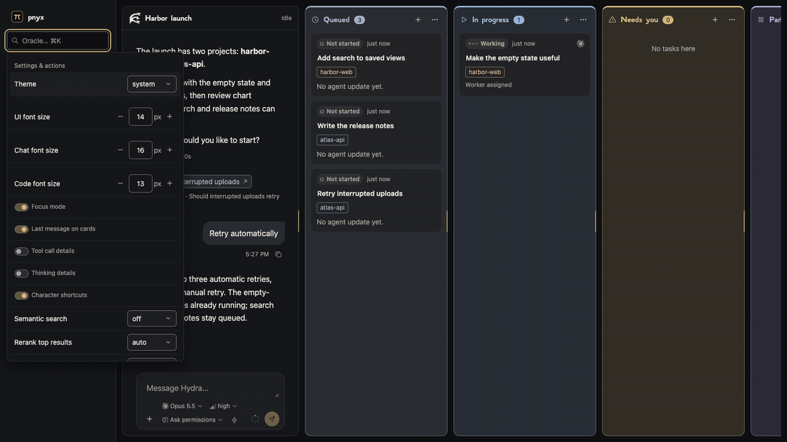

# Pnyx

Pnyx brings your coding agents and their work into one local app.

It is for people working with Claude Code, Codex, or both across several projects. Talk to a **Hydra**, follow its tasks, and answer the questions that need you.

Every change is saved in an append-only event log, so work and conversations stay readable after a session ends.

Pnyx runs the agents you ask it to start; Hydra decides what to do.

The plain CLI is `pnyx`. Pnyx is pre-v1.



Recorded on the current app in dark mode, with made-up projects, tasks and agents in an isolated data home.

## Install

You need Node 22.13 or newer, pnpm at the version pinned in `package.json`, and PostgreSQL 15 or newer with `wal_level=logical` for Pnyx's data (`brew install postgresql@17`, then `pnyx setup postgres` starts and configures it).

Install and sign in to [Claude Code](https://code.claude.com/docs/en/overview), [Codex](https://developers.openai.com/codex/cli/), or both to run agents.

```sh
brew install postgresql@17
git clone https://github.com/leonardourci/pnyx.git
cd pnyx
pnpm install
pnpm run build
pnpm add -g "$PWD"
pnyx --version
pnyx setup postgres
```

If pnpm's global bin directory is missing from PATH, run `pnpm setup`, reopen your terminal, and retry the global install. You can also run `./dist/cli/pnyx.js` directly from the clone.

The global install links this clone. Send `/upgrade` in Hydra's chat to pull `main`, install dependencies, build, check the data and restart the server. If your current executable is `pnyx-axi`, follow the [migration steps](docs/pnyx.md#migrate-from-pnyx-axi).

GitHub integration needs [GitHub CLI](https://cli.github.com/), `gh auth login`, and [gh-axi](https://github.com/kunchenguid/gh-axi) on PATH.

[quota-axi](https://github.com/kunchenguid/quota-axi) ranks dispatch candidates by account quota. Hooks, global skills and the login service are optional setup steps described in the [reference](docs/pnyx.md).

## Quick start

### 1. Run Pnyx

Start the foreground server:

```sh
pnyx serve
```

Open the URL it prints. One server serves all your Hydras; the default address is `http://127.0.0.1:4747`.

Keep that terminal running while you use Pnyx.

For an owner-facing trial with separate data, use portless when it is installed so the owner gets a stable link:

```sh
PNYX_HOME=/path/to/trial portless trial.pnyx pnyx serve
```

Choose a unique `<name>.pnyx` for each trial and share the URL portless prints. Leave `--port` unset so Pnyx uses the `PORT` portless supplies. Without portless, run `PNYX_HOME=/path/to/trial pnyx serve --port 0` and share the printed URL. Automated tests keep their random ports.

Use the same `PNYX_HOME` for every command in that trial. A separate home still uses your normal harness logins and global skill folders.

Setup commands change user-wide configuration and report the selected home when it differs from the default. See [data and privacy](docs/data.md) before sharing a data folder or removing it.

### 2. Attach a project

Create a Hydra and attach a project in the UI. Select your Hydra in the header, then choose a model for your signed-in harness in Hydra's composer.

### 3. Talk to Hydra

Send a message in Hydra's composer, for example:

> Look at this project and help me plan a small improvement.

The first message starts Hydra's agent session. Hydra reports missing setup in chat. Sign in through the harness when a login is needed. Use Settings to configure dispatch rules and accounts.

### 4. Start a task

Ask Hydra to start an agreed task, or create and start one from the CLI:

```sh
pnyx task create --title "Improve the empty state" --project project \
  --brief "Explain the empty state and add a useful next action." --hydra work
```

Replace `project` with the attached folder's name and `work` with your Hydra's ID. Use `--harness codex` if that is your signed-in harness.

Open the card to follow the worker's updates, and send follow-up instructions through Hydra's chat. Stop a foreground server with Ctrl+C.

## Core ideas

### Hydra

A Hydra is an orchestrator and its tasks. It can work across several projects, keep context, dispatch workers, and bring decisions back to you.

The **Waiting on you** strip keeps open questions and permissions within reach.

### Tasks and columns

A task holds your ask, its brief, updates, conversation and links. Its badge, chat and CLI share one status: hosted turns and hooks supply running or idle, the worker's log supplies needs you, blocked or done, and the task supplies its queue, hold and pull request facts.

You can create tasks and columns inline and move cards yourself. A finished agent turn leaves the task open until its completion requirements are met.

### Workers

Each task has at most one attached worker at a time. Pnyx can host Claude Code and Codex, or run your own command.

Workers report their state and send questions to Hydra. Hooks also let you attach existing interactive sessions.

### Projects and landing

A project is a folder attached to a Hydra. Workers normally get isolated project copies.

Work lands through a ready pull request by default, with you deciding when to merge. A project can keep completed work on a branch.

### Memory and Oracle

Owner memory is shared across Hydras, project memory follows a project, and Hydra memory keeps that Hydra's local context. **inscribe** summarizes durable context before a reset and identifies memory changes that still need to be saved.

The **Oracle** searches tasks, their events and notes by keyword, matching word forms, synonyms and near spellings. It reads new history into a derived SQLite cache when you search.

## CLI reference

Use `pnyx --help` for syntax and the [plain CLI reference](docs/pnyx.md) for details. Workers append reports to worker.log. Transitional read commands remain available while the app moves to its file store.

| Command | Description |
| --- | --- |
| `pnyx board` | Show the current Hydra. |
| `pnyx task create` | Create a task and start its worker. |
| `pnyx send --text <message>` | Send to Hydra, or add `--task <id>` for a worker. |
| `pnyx answer <task> <question> --text <answer>` | Answer a saved question. |
| `pnyx serve` | Run the app server. |
| `pnyx setup` | Set up the service, hooks or skills. |
| `pnyx debug health` | Check the running app. |

### Flags

| Flag | Description |
| --- | --- |
| `--hydra <name>` | Hydra to use (default: assigned Hydra or `default`). |
| `--json` | Print a JSON receipt for a script. |
| `--port <n>` | Port for `serve`; `0` picks a free one. |
| `--event-id <id>` | On writes, an idempotency key; a repeat returns the original receipt. |
| `--if-revision <n>` | On writes, the expected card revision (`0` for a new card). |
| `--help`, `--version` | Show command help or the installed version. |

## Documentation

- [pnyx reference](docs/pnyx.md): immediate actions and transitional reads.
- [Hooks and sessions](docs/hooks-and-sessions.md): attach existing agents and deliver replies.
- [Data, privacy and uninstall](docs/data.md): storage, retained history and removal.
- [Development](docs/development.md): build, tests and verification.
- [Contributing](CONTRIBUTING.md): propose a change and open a pull request.
- [Security](SECURITY.md): report a vulnerability privately.

## License

[Apache-2.0](LICENSE). Copyright 2026 Leonardo G. Urci.

Bundled third-party fonts, icons and artwork keep their own licenses; see [THIRD-PARTY-NOTICES.md](THIRD-PARTY-NOTICES.md).
