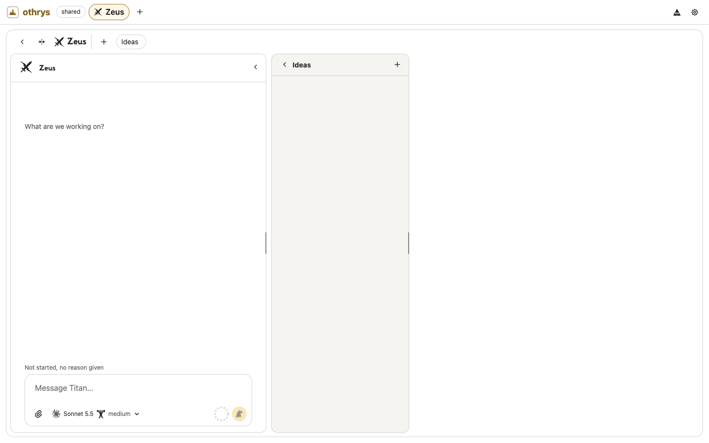

# Othrys

Othrys brings your coding agents and their work into one local app.

It is for people working with Claude Code, Codex, or both across several projects. Talk to a **Titan**, follow its tasks, and answer the questions that need you.

Every change is saved in an append-only event log, so work and conversations stay readable after a session ends.

Othrys runs the agents you ask it to start; Titan decides what to do.

The plain CLI is `othrys`. Othrys is pre-v1.



A new Titan on the current app in light mode, captured in an isolated data home.

## Install

You need Node 22.13 or newer and pnpm at the version pinned in `package.json`. Othrys saves its state in local files; no database service is required.

Install and sign in to [Claude Code](https://code.claude.com/docs/en/overview), [Codex](https://developers.openai.com/codex/cli/), or both to run agents.

```sh
git clone https://github.com/leonardourci/othrys.git
cd othrys
pnpm install
pnpm run build
pnpm add -g "$PWD"
othrys --version
```

If pnpm's global bin directory is missing from PATH, run `pnpm setup`, reopen your terminal, and retry the global install. You can also run `./dist/cli/othrys.js` directly from the clone.

The global install links this clone. If your installation uses Postgres, follow the [migration steps](docs/othrys.md#migrate-from-a-postgres-installation). For an installation already using native files, send `/upgrade` in Titan's chat to move to the newest release, install dependencies, build and restart the server; the development channel follows `main` instead (see [Releases](docs/development.md#releases)).

GitHub integration needs [GitHub CLI](https://cli.github.com/), `gh auth login`, and [gh-axi](https://github.com/kunchenguid/gh-axi) on PATH.

[quota-axi](https://github.com/kunchenguid/quota-axi) ranks dispatch candidates by account quota. Hooks, global skills and the login service are optional setup steps described in the [reference](docs/othrys.md).

## Quick start

### 1. Run Othrys

Start the foreground server:

```sh
othrys serve
```

Open the URL it prints. One server serves all your Titans; the default address is `http://127.0.0.1:4747`.

Keep that terminal running while you use Othrys.

For an owner-facing trial with separate data, use portless when it is installed so the owner gets a stable link:

```sh
OTHRYS_HOME=/path/to/trial portless trial.othrys othrys serve
```

Choose a unique `<name>.othrys` for each trial and share the URL portless prints. Leave `--port` unset so Othrys uses the `PORT` portless supplies. Without portless, run `OTHRYS_HOME=/path/to/trial othrys serve --port 0` and share the printed URL. Automated tests keep their random ports.

Use the same `OTHRYS_HOME` for every command in that trial. A separate home still uses your normal harness logins and global skill folders.

Setup commands change user-wide configuration and report the selected home when it differs from the default. See [data and privacy](docs/data.md) before sharing a data folder or removing it.

### 2. Attach a project

Create a Titan and attach a project in the UI. Select your Titan in the header, then choose a model for your signed-in harness in Titan's composer.

### 3. Talk to Titan

Send a message in Titan's composer, for example:

> Look at this project and help me plan a small improvement.

The first message starts Titan's agent session. Titan reports missing setup in chat. Sign in through the harness when a login is needed. Use Settings to configure dispatch rules and accounts.

### 4. Start a task

Ask Titan to start an agreed task, or create and start one from the CLI:

```sh
othrys task create --title "Improve the empty state" --project project \
  --brief "Explain the empty state and add a useful next action." --titan work
```

Replace `project` with the attached folder's name and `work` with your Titan's ID. Use `--harness codex` if that is your signed-in harness.

Open the card to follow the worker's updates, and send follow-up instructions through Titan's chat. Stop a foreground server with Ctrl+C.

Writing fields wrap and grow with their text; chat drafts keep their height limit and scroll inside. Enter keeps each field’s submit or focus action, and Shift+Enter adds a line only in multiline fields. On a touch screen, Enter in a chat draft adds a line and only Send sends. Select text in a reply to comment on it or quote it, from the pill by the selection or the bar above the composer.

## Core ideas

### Titan

A Titan is an orchestrator and its tasks. It can work across several projects, keep context, dispatch workers, and bring decisions back to you.

The **Waiting on you** strip keeps open questions and permissions within reach.

### Tasks and columns

A task’s Description holds its instructions. Write it when creating the task or change it with Edit task. The worker receives it when starting. Saved edits go into the attached worker’s inbox, and Othrys delivers them automatically to eligible hosted sessions. A task also holds updates, conversation and links. Its badge, chat and CLI share one status: hosted turns and hooks supply running or idle, the worker's log supplies needs you, blocked or done, and the task supplies its queue, hold and pull request facts.

You can create tasks and columns inline and move cards yourself. A finished agent turn leaves the task open until its completion requirements are met.

### Workers

Each task has at most one attached worker at a time. Othrys can host Claude Code and Codex, or run your own command.

Workers report their state and send questions to Titan. Hooks also let you attach existing interactive sessions.

### Projects and landing

A project is a folder attached to a Titan. Workers normally get isolated project copies.

Work lands through a ready pull request by default, with you deciding when to merge. A project can keep completed work on a branch.

### Memory and Oracle

Owner memory is shared across Titans, project memory follows a project, and Titan memory keeps that Titan's local context. **inscribe** summarizes durable context before a reset and identifies memory changes that still need to be saved.

The **Oracle** searches tasks, their events and notes by keyword, matching word forms, synonyms and near spellings. It reads new history into a derived SQLite cache when you search.

## CLI reference

Use `othrys --help` for syntax and the [plain CLI reference](docs/othrys.md) for details. Workers append reports to their assigned `worker.log`. Titan and workers read `titan.log`, `task.log`, `worker.log` and the optional snapshot directly.

| Command | Description |
| --- | --- |
| `othrys titan` | Show the current Titan. |
| `othrys task create` | Create a task and start its worker. |
| `othrys task ack` | Acknowledge one instruction read by its assigned worker. |
| `othrys send --text <message>` | Send to Titan, or add `--task <id>` for a worker. |
| `othrys answer <task> <question> --text <answer>` | Answer a saved question. |
| `othrys serve` | Run the app server. |
| `othrys setup` | Set up the service, hooks or skills. |
| `othrys debug health` | Check the running app. |

### Flags

| Flag | Description |
| --- | --- |
| `--titan <name>` | Titan to use (default: assigned Titan or `default`). |
| `--json` | Print a JSON receipt for a script. |
| `--port <n>` | Port for `serve`; `0` picks a free one. |
| `--idempotency-key <key>` | Retry `send` with the same key and message if its receipt is lost. |
| `--event-id <id>` | Reuse the same ID when retrying `task create`. |
| `--help`, `--version` | Show command help or the installed version. |

## Documentation

- [othrys reference](docs/othrys.md): immediate actions and native records.
- [Hooks and sessions](docs/hooks-and-sessions.md): attach existing agents and deliver replies.
- [Data, privacy and uninstall](docs/data.md): storage, retained history and removal.
- [Open Othrys from your phone](docs/remote-access.md): Tailscale Serve, allowed host names and installing the app.
- [Development](docs/development.md): build, tests and verification.
- [Contributing](CONTRIBUTING.md): propose a change and open a pull request.
- [Security](SECURITY.md): report a vulnerability privately.

## License

[Apache-2.0](LICENSE). Copyright 2026 Leonardo G. Urci.

Bundled third-party fonts, icons and artwork keep their own licenses; see [THIRD-PARTY-NOTICES.md](THIRD-PARTY-NOTICES.md).
