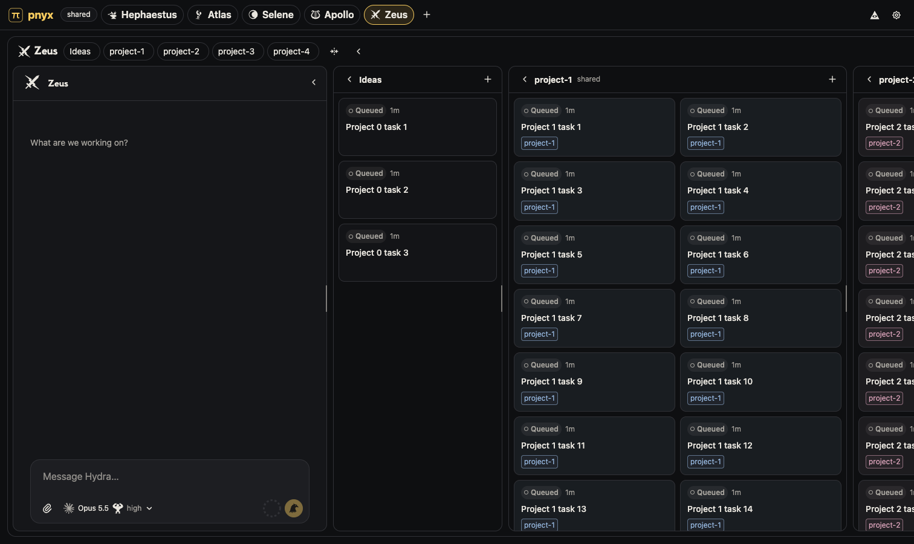
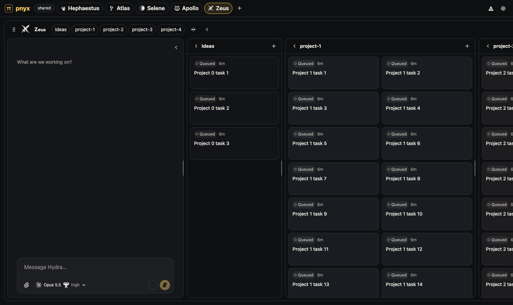
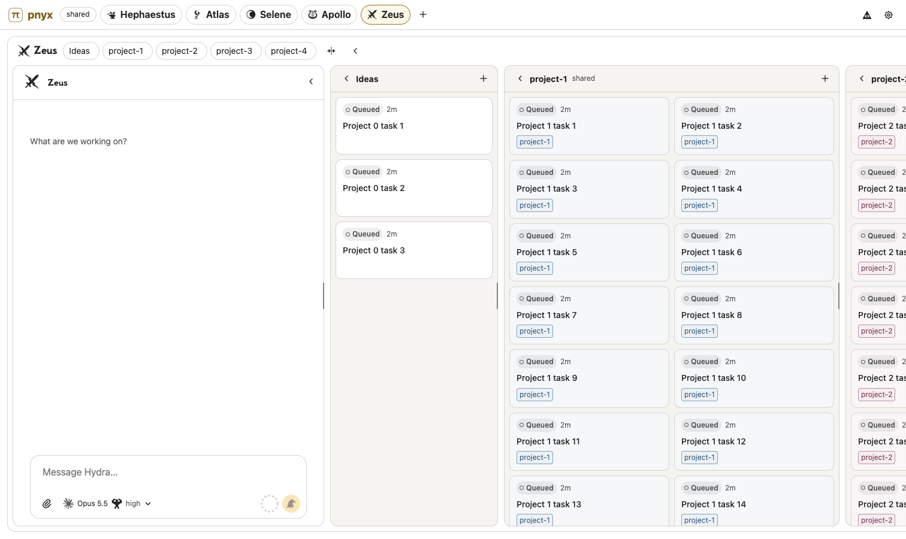
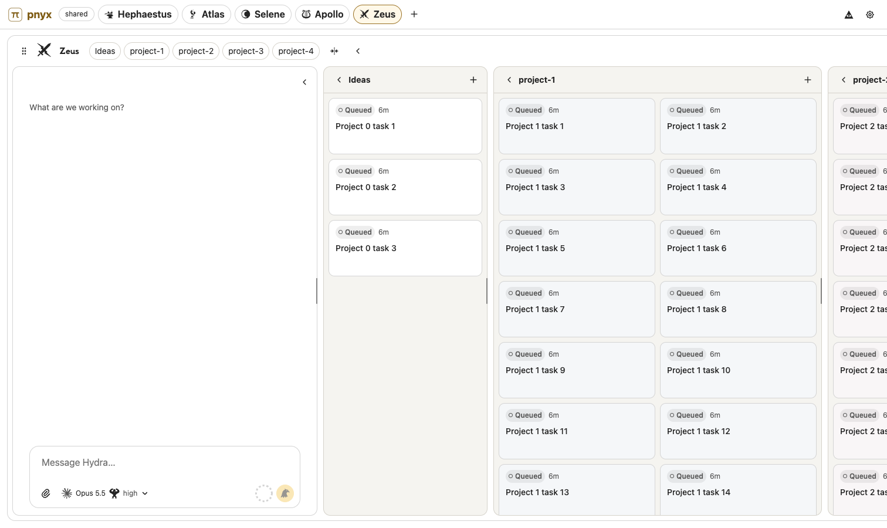

## Intent

Keep every Hydra, project column and task present while scrolling, and remove labels already supplied by the surrounding workspace.

## Problem

Three layers of windowing mounted content only after scrolling into view. Closed cards also ignored the workspace's project-label rule, and the frame, chat and column headers repeated names and counts.

## Fix

Render project columns as a flex strip and task families in normal flow. Task navigation uses its existing unfolding and scrolling path; the row virtualizer's duplicate reveal effect is deleted. Keep all Hydra bodies mounted. Project-chip navigation scrolls only the workspace axis, preserving other scroll positions. Closed cards follow the same project-label rule as open cards; Oracle previews retain their project chip by default. Rename and icon editing live in the frame header, with a separate drag handle. Frame project chips omit counts, and columns show only poleis different from their Hydra's.

```text
web/src/
├── app/
│   └── workspace-sizing.ts ⇐ (from workspace-window.ts): folding size animation
├── shared/ui/
│   ├── +layout-geometry.ts: retained chat and drag geometry from scroll-offset.ts
│   ├── -scroll-offset.ts: removed windowing hooks
│   ├── +strip.tsx: flex strip and column navigation
│   └── -windowed-strip.tsx: removed column virtualizer
└── tasks/
    └── -card-height.ts: removed unused height tracking
```

Background mounting remains a follow-up if real Hydras grow toward hundreds of tasks. The current implementation mounts everything immediately and can increase initial rendering cost at that scale.

## Validation

At 1512×900, on the same isolated synthetic fixture with five Hydras and 131 tasks, I measured:

| Measurement | Before | After |
| --- | ---: | ---: |
| Mounted cards | 35 | 131 |
| First card DOM arrival | 276 ms | 550 ms |
| Longest load frame | 148 ms | 261 ms |
| Longest vertical scroll frame | 116 ms | 83 ms |
| Longest horizontal scroll frame | 81 ms | 82 ms |

Single warm-load comparison on a shared machine; timings are observations, not statistically stable benchmarks. Scroll measurements use six programmatic steps separated by painted frames. The automated performance journey also exercises real wheel input.

On final head `681f21216`, [required CI 44502567915](https://github.com/leonardourci/pnyx/actions/runs/44502567915) and deslop pass. Local lint, typecheck, CSS and build pass. Focused journeys cover frame editing and pointer access, normal-flow rows, mounted drafts and families, phone layout in both themes, column navigation and modal closing. Both normal and profiling performance journeys pass, including update isolation across the other Hydras. The normal build is restored.

The full local browser batch passed all 27 board cases, normal performance and three of four motion cases. Its opening-card containment failure is associated with unmerged #420; required CI passes. Later affected checks passed after the main merge and review fixes. Modal slot capture samples bounds and scroll atomically on every frame across a 900 ms stability window, retaining the below-0.5 px placeholder rounding allowance and 1 px closing-path allowance. This prevents the 7 px capture drift observed with frame/finite-animation-only settling. The wheel reaches its destination before separate task navigation, so remaining input momentum does not overwrite the reveal.

Regression proof against the baseline: the single-project chip assertion failed with the extra repository label, and the performance journey failed with only 20 of 129 workspace cards mounted. Existing off-screen draft and legacy-family tests now assert that their content stays mounted.

Dark, then light theme, at 1512×900:

| Before | After |
| --- | --- |
|  |  |
|  |  |

## Review

Review fixes include the frame drag grip, chip-visibility memo dependency, bounded sampling registered before its trigger, saved name/icon confirmation, header pointer access, axis-only project navigation and direct single-column rows. Card navigation uses its existing unfolding and scrolling path. Tests assert other-column scroll preservation, repeated reveals through the rendered chat reference, continuous modal slot presence and task-render isolation in every other Hydra. Existing poleis coverage checks badge transitions; the frame journey covers editing and dragging. Findings in merged #417/#418 code were reported separately and their local edits reverted.

All review findings are fixed. Required CI and the published deslop proof pass on `681f21216`. CodeRabbit challenger review remains pending.

The same repeat-reveal stability assertion fails on `origin/main` (`c8d6e63f`): column scroll moves from 3,487 to 3,682 px, a 195 px drift. I excluded that existing navigation bug from this PR; the off-screen reveal and other-column checks remain. Hydra will track repeated-reveal stability separately.

